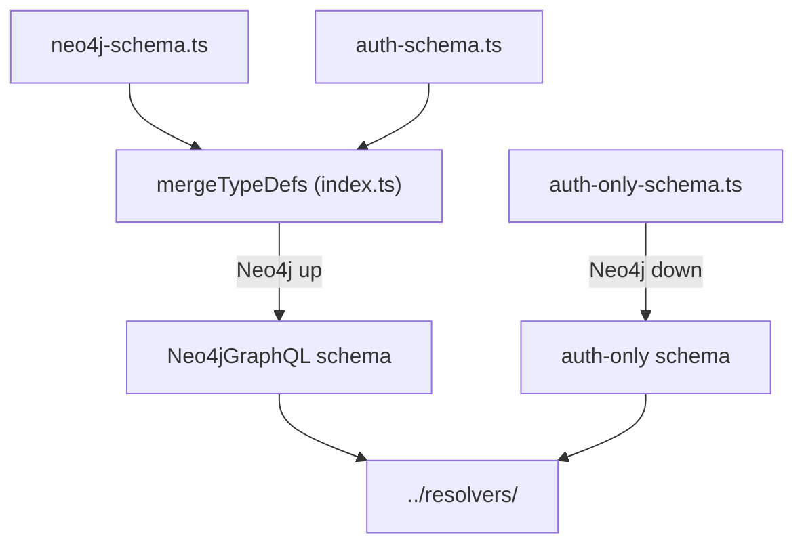

# `packages/server/src/schema/` — GraphQL type definitions

The shape of the GraphQL API, as SDL strings. The graph types are handed to
`@neo4j/graphql`, which generates queries, mutations and subscriptions that
run as Cypher; the auth types are answered by the SQLite resolvers.
[`../index.ts`](../index.ts) picks which set to serve.

## What's here

| Path | What it is |
| --- | --- |
| [`neo4j-schema.ts`](neo4j-schema.ts) | `typeDefs`: `Graph`, `WorkItem`, `Edge`, `User`, `Team`, `Contributor`, their enums and `@relationship` links, with `@authentication` / `@authorization` rules that scope reads and writes to the JWT user. Start here to see the data model. |
| [`auth-schema.ts`](auth-schema.ts) | `authTypeDefs`: sign-in payloads and inputs, folders, system settings, OAuth provider config, the custom `Query` / `Mutation` fields and `restoreWorkItem`. Merged with the Neo4j types. |
| [`auth-only-schema.ts`](auth-only-schema.ts) | `authOnlyTypeDefs`: a standalone copy with every type the auth resolvers need, served when Neo4j is unreachable. |

The web app's queries against this schema are in
`packages/web/src/lib/queries.ts` and `packages/web/src/graphql/graph.ts`.

Up: [`src/`](../README.md)
