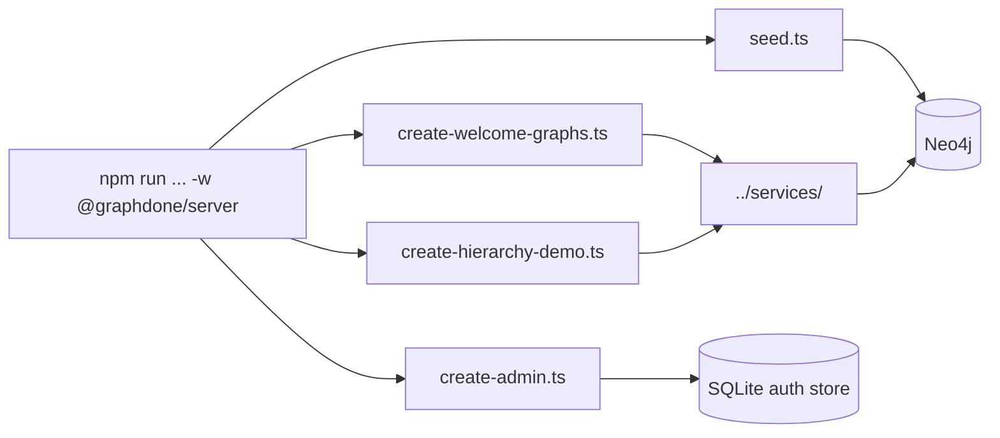

# `packages/server/src/scripts/` — one-off data scripts

Command-line scripts for putting data into a development database or checking
it. They are not part of the running server. Each one is run with `tsx` through
an `npm run` script in [`../../package.json`](../../package.json).

## What's here

| Path | npm script | What it does |
| --- | --- | --- |
| [`seed.ts`](seed.ts) | `db:seed` | **Deletes everything in Neo4j** (`MATCH (n) DETACH DELETE n`), then loads sample graphs and work items. Used by `scripts/stack/run.sh` and the VM setup. |
| [`create-welcome-graphs.ts`](create-welcome-graphs.ts) | `create-welcome-graphs` | Creates the shared read-only Welcome graph if it is missing. |
| [`create-hierarchy-demo.ts`](create-hierarchy-demo.ts) | `create-hierarchy-demo` | Creates the "graphs of graphs" demo if missing; `--force` recreates it. |
| [`create-admin.ts`](create-admin.ts) | `create-admin` | Despite the name, only checks that an `admin` account exists. The server creates it on first start (password from `ADMIN_PASSWORD`, or generated in production). |
| [`create-test-graphs.ts`](create-test-graphs.ts) | none | Writes a few test graphs to a hard-coded local Neo4j. No npm script runs it. |

Database connection: `seed.ts` reads `NEO4J_URI`, `NEO4J_USER` and
`NEO4J_PASSWORD` from `packages/server/.env`; the Welcome and hierarchy scripts
use the shared driver in [`../db.ts`](../db.ts); `create-test-graphs.ts`
hard-codes `bolt://localhost:7687`.

Up: [`src/`](../README.md)
