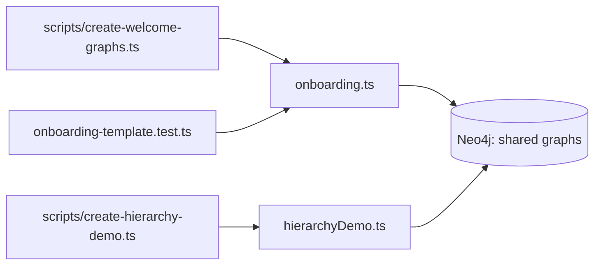

# `packages/server/src/services/` — starter graph content

Code that writes ready-made, shared graphs into Neo4j so a new install has
something to explore. The functions are idempotent: they check whether the
graph exists before creating it. They are called by the scripts in
[`../scripts/`](../scripts/README.md), not by the running server.

## What's here

| Path | What it is |
| --- | --- |
| [`onboarding.ts`](onboarding.ts) | The shared Welcome graph: `WELCOME_NODES` (tutorial items with markdown text and pinned positions), `WELCOME_EDGES`, and `createSharedWelcomeGraph` / `sharedWelcomeGraphExists`. |
| [`onboarding-template.test.ts`](onboarding-template.test.ts) | Vitest check that the Welcome layout follows the app's rules: every node pinned, edges purely horizontal or vertical, enough room for edge labels. |
| [`hierarchyDemo.ts`](hierarchyDemo.ts) | A "graphs of graphs" demo: an overview graph whose nodes drill into sub-graphs (about 2,600 items in all), shared so guests can see it. `createHierarchyDemo`, `hierarchyDemoExists`, `deleteHierarchyDemo`. |

The Welcome graph is protected from deletion by
[`../resolvers/graph-protection.ts`](../resolvers/graph-protection.ts).

Up: [`src/`](../README.md)
