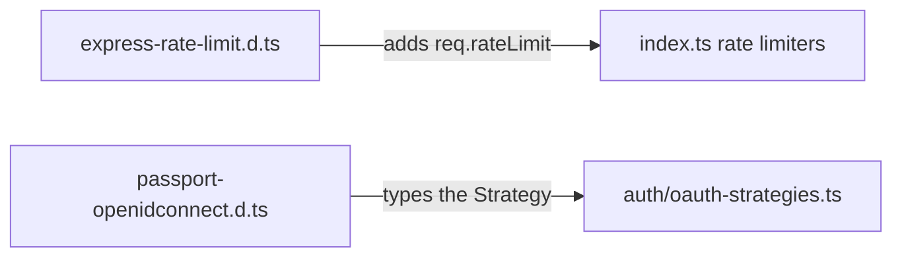

# `packages/server/src/types/` — type declarations for libraries

TypeScript declaration files that fill gaps in third-party typings. They hold
no runtime code; `tsc` picks them up so the server compiles cleanly.

## What's here

| Path | What it is |
| --- | --- |
| [`express-rate-limit.d.ts`](express-rate-limit.d.ts) | Adds the `rateLimit` field (limit, current, remaining, reset time) to Express's `Request`. |
| [`passport-openidconnect.d.ts`](passport-openidconnect.d.ts) | Declares the `passport-openidconnect` module, which ships no types; used for LinkedIn sign-in. |

Up: [`src/`](../README.md)
