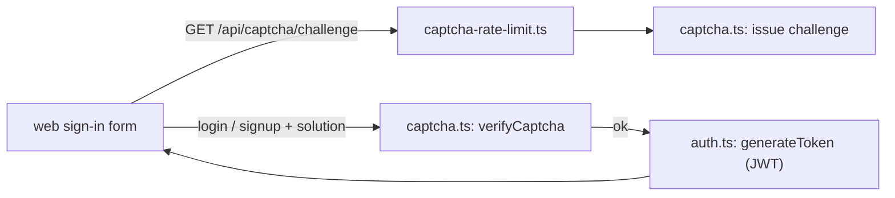

# `packages/server/src/utils/` — tokens and CAPTCHA

Small helpers shared by the sign-in code: signing and checking the JWTs the
web app sends, and the self-hosted proof-of-work CAPTCHA (ALTCHA) that guards
login, signup and email-link actions.

## What's here

| Path | What it is |
| --- | --- |
| [`auth.ts`](auth.ts) | `generateToken` / `verifyToken`: JWTs carrying `userId`, `email`, `role` and `authVersion`, signed with `JWT_SECRET`, lifetime `JWT_EXPIRES_IN` (default 24h). |
| [`captcha.ts`](captcha.ts) | ALTCHA challenge creation and verification for the actions `login`, `signup`, `magic-link`, `forgot-password`, `reset-password`; each solution works once. In development and test, `login` and `signup` skip it. |
| [`captcha-rate-limit.ts`](captcha-rate-limit.ts) | 30 challenges per minute per socket address. |

The production start-up check for `JWT_SECRET` and `ALTCHA_HMAC_KEY` is in
[`../config/secrets.ts`](../config/secrets.ts). The web side is
`packages/web/src/components/AuthCaptcha.tsx`.

Up: [`src/`](../README.md)
