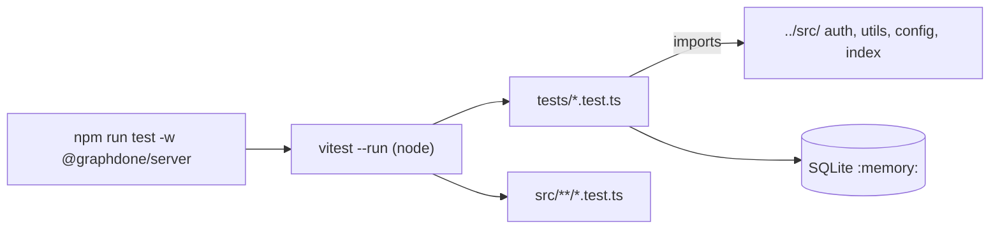

# `packages/server/tests/` — server tests

Vitest tests for the security boundaries of the API: sign-in, CAPTCHA, OAuth,
email links, login limits, folder access, graph deletes and safe start-up. Most drive the real
modules (Express handlers, GraphQL resolvers, the SQLite auth store on an
in-memory database) with Neo4j and network calls mocked, so they need no
running services.



## What's here

| Path | What it covers |
| --- | --- |
| [`captcha.test.ts`](captcha.test.ts), [`captcha-auth.test.ts`](captcha-auth.test.ts) | The ALTCHA service on its own, then at the real GraphQL login/signup boundary (forged, reused and wrong-action proofs; forwarded-IP tricks). |
| [`magic-link.test.ts`](magic-link.test.ts), [`auth-link-boundary.test.ts`](auth-link-boundary.test.ts) | Single-use, purpose-bound email links, including concurrent redemption and disabled accounts. |
| [`oauth-identity.test.ts`](oauth-identity.test.ts), [`oauth-profiles.test.ts`](oauth-profiles.test.ts), [`oauth-strategies.test.ts`](oauth-strategies.test.ts) | Linking provider identities to accounts, trusting only verified provider emails, and start-up failure for half-configured providers. |
| [`password-login-limiter.test.ts`](password-login-limiter.test.ts), [`password-login-limits.test.ts`](password-login-limits.test.ts) | The limiter's accounting, then real HTTP 429s for aliased login mutations. |
| [`folder-authorization.test.ts`](folder-authorization.test.ts) | Folder queries and mutations need authentication and never cross owners. |
| [`graph-protection.test.ts`](graph-protection.test.ts) | `deleteGraphs` refuses a graph that still holds graphs, unless they are in the same delete. |
| [`production-secrets.test.ts`](production-secrets.test.ts), [`production-startup.test.ts`](production-startup.test.ts), [`development-startup.test.ts`](development-startup.test.ts) | Secret checks run before the API loads; `.env` is read first; development defaults. |
| [`server.test.ts`](server.test.ts) | A placeholder that asserts on local constants only. |

Two more test files sit next to their code:
[`../src/config/tls.test.ts`](../src/config/tls.test.ts) and
[`../src/services/onboarding-template.test.ts`](../src/services/onboarding-template.test.ts).

## How to run / use

```bash
npm run test -w @graphdone/server            # vitest --run
npm run test:coverage -w @graphdone/server
```

Up: [`packages/server/`](../README.md)
