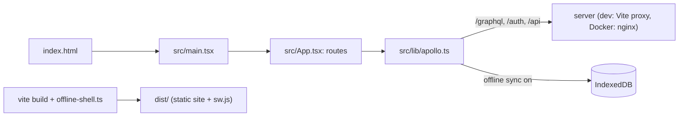

# `packages/web/` — the web app (`@graphdone/web`)

The GraphDone user interface: a React single-page app built with Vite, styled
with Tailwind, with the graph canvas drawn in D3. It talks to the API in
[`packages/server/`](../server/README.md) through Apollo Client. The same build
also powers the hosted site (graphdone.com), where offline sync is switched on
and guests work in a workspace stored in their own browser.



## What's here

| Path | What it is |
| --- | --- |
| [`src/`](src/README.md) | All application code. Start at [`src/App.tsx`](src/App.tsx). |
| [`public/`](public/) | Copied unchanged into the root of the built site, so everything in it is publicly served (which is why it has no README): [`favicon.svg`](public/favicon.svg) (tab icon and loading screens), [`manifest.json`](public/manifest.json), [`paper-grain.svg`](public/paper-grain.svg) (background texture used by `src/index.css`), and [`schemas/project-v1.schema.json`](public/schemas/project-v1.schema.json), the JSON Schema for exported project files, served at `/schemas/` (format notes in [`docs/formats/`](../../docs/formats/README.md)). |
| [`index.html`](index.html) | The HTML shell Vite builds from; shows a loading screen until React mounts. |
| [`vite.config.ts`](vite.config.ts) | Dev server on `PORT` (default 3127) with proxies for `/graphql`, `/api/graphql`, `/api/agent`, `/api/ops`, `/api/captcha`, `/auth`, `/config`, `/health` and `/mcp` to the API on 4127 (`/api/sync` to 8797); `@graphdone/core` aliased to `../core/src`; vendor chunk split; Vitest settings (jsdom, `src/test/setup.ts`). |
| [`offline-shell.ts`](offline-shell.ts) | Vite plugin. When `VITE_OFFLINE_SYNC=true`, writes `dist/sw.js`, a service worker that precaches the built app so it opens offline. API routes are never cached. |
| `tailwind.config.js`, `postcss.config.js` | Styling build. |
| `Dockerfile`, [`nginx.conf`](nginx.conf), `https_redirect.html` | Production image: builds the app, serves `dist/` from nginx over HTTPS on 3128 and proxies API paths to the server container. `https_redirect.html` is shown when plain HTTP reaches the HTTPS port. `Dockerfile.dev` is the development image for `deployment/docker-compose.dev.yml`. |
| `.env.example` | Sample `VITE_*` settings for local development. |
| `package.json`, `tsconfig.json`, `eslint.config.js` | Scripts, compiler and lint settings. |
| `vite.config.ts.timestamp-*.mjs` | A temporary file Vite left behind in 2025 and that was committed by mistake; nothing uses it, and its deletion is tracked in #269. |

Build flags read by the code: `VITE_GRAPHQL_URL`, `VITE_GRAPHQL_WS_URL`,
`VITE_API_URL` (hosted API origin), `VITE_OFFLINE_SYNC` (browser-local
workspace and service worker) and `VITE_HOSTED_USAGE` (usage meters).

## How to run / use

```bash
npm run dev -w @graphdone/web         # frees the port, then starts Vite on 3127
npm run build -w @graphdone/web       # tsc && vite build -> dist/
npm run test -w @graphdone/web        # vitest --run --reporter=verbose
npm run typecheck -w @graphdone/web
```

The API must be running for sign-in; the root `./start` launcher starts both.
Browser tests (Playwright) for this app live in [`tests/`](../../tests/README.md).

Up: [`packages/`](../README.md)
