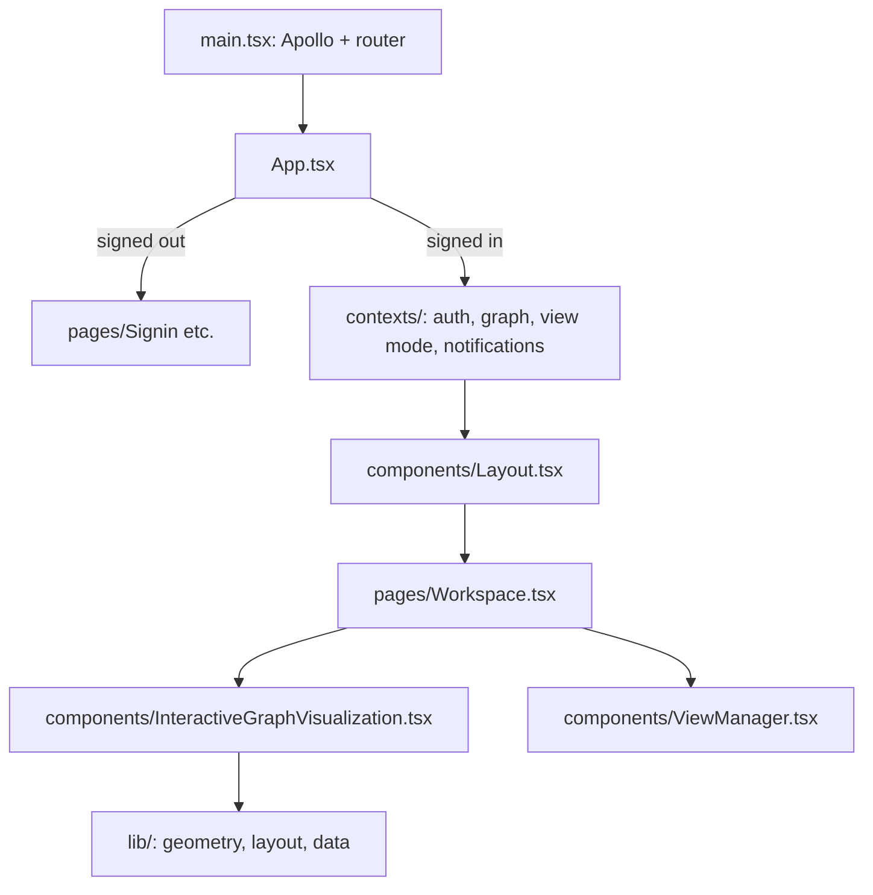

# `packages/web/src/` — web app source

All the code of the React app. Read it top-down: [`main.tsx`](main.tsx) sets up
Apollo and the router, [`App.tsx`](App.tsx) chooses between the signed-out
pages and the signed-in shell, and [`pages/Workspace.tsx`](pages/Workspace.tsx)
is the main screen (the graph canvas or one of the list views).

## What's here

| Path | What it is |
| --- | --- |
| [`main.tsx`](main.tsx) | Entry point: applies the saved or `?theme=` theme, mounts `ApolloProvider` and `BrowserRouter`, registers the offline service worker in production when offline sync is on. |
| [`App.tsx`](App.tsx) | Providers and routes. Signed out: `/`, `/login`, `/signup`, `/forgot-password`, `/reset-password`. Signed in: `/` (workspace), `/ontology`, `/agents`, `/analytics`, `/settings`, `/admin`, `/backend`. `/agent-approval` and `/share` work either way. |
| [`index.css`](index.css) | Tailwind layers plus app-wide CSS (graph styling, animations, themes). |
| `vite-env.d.ts` | Types for the `VITE_*` build variables. |
| [`pages/`](pages/README.md) | One component per route. |
| [`components/`](components/README.md) | UI building blocks: the graph canvas, views, modals, sign-in, admin panels. |
| [`contexts/`](contexts/README.md) | React providers for session, current graph, view mode and notifications. |
| [`hooks/`](hooks/README.md) | Reusable hooks (dialogs, layout saving, health, device quality). |
| [`lib/`](lib/README.md) | Non-visual logic: Apollo client, GraphQL documents, graph geometry and level of detail, offline workspace, storage. |
| [`constants/`](constants/README.md) | Labels, colours and icons for item types, statuses, priorities and relationships. |
| [`graphql/`](graphql/README.md) | GraphQL documents for graphs (projects). |
| [`types/`](types/README.md) | Shared TypeScript types for graphs, work items and auth. |
| [`utils/`](utils/README.md) | Small helpers: graph data validation, form validation, app version. |
| [`examples/`](examples/README.md) | A radar chart demo component (not routed). |
| [`test/`](test/README.md) | Vitest setup file. |

Unit tests sit next to the code (`*.test.ts(x)`) or in `__tests__/` folders;
`npm run test -w @graphdone/web` runs them all.

Up: [`packages/web/`](../README.md)
