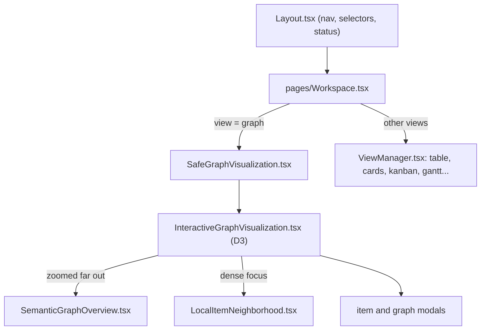

# `packages/web/src/components/` — UI components

The building blocks of every screen (about 90 files). The centre of the app is
[`InteractiveGraphVisualization.tsx`](InteractiveGraphVisualization.tsx), the
D3 graph canvas (over 6,000 lines). The list-style views are switched by
[`ViewManager.tsx`](ViewManager.tsx). Both are mounted by
[`../pages/Workspace.tsx`](../pages/Workspace.tsx) inside the
[`Layout.tsx`](Layout.tsx) shell. Pure logic they use (geometry, layout, level
of detail) lives in [`../lib/`](../lib/README.md), not here.

## What's here

| Group | Files | What they do |
| --- | --- | --- |
| Graph canvas | `InteractiveGraphVisualization`, `SafeGraphVisualization`, `GraphErrorBoundary` | The D3 force-directed canvas: item cards, typed edges with labels, zoom level of detail, drag and layout saving, undo, context menus. The wrapper adds an error boundary. |
| Overview and focus layers | `SemanticGraphOverview`, `OverviewBusLayer`, `SemanticTraceControls`, `SemanticRelationshipBrowser`, `LocalItemNeighborhood`, `LocalItemNeighborhoodView`, `GraphStatusDock` | Display-only layers drawn over the canvas: grouped summaries when zoomed out, relationship "buses" and traces, and a readable page of neighbours around a dense item. They never move real items. See [`docs/architecture/`](../../../../docs/architecture/README.md). |
| Canvas controls and inspection | `NodeInspector`, `NodeQuickEdit`, `QuickEditSurface`, `NodeSubgraphPreview`, `NodeContentRenderer`, `CopyableId`, `MiniMap`, `PhoneGraphControls`, `RelationshipPriorityControl`, `LayoutSaveStatus` | Side panel for a selected item (markdown body, sub-graph preview), inline quick edit, minimap, phone zoom/lock controls, the relationship priority level control, layout-save indicator. |
| List and chart views | `ViewManager`, `WorkspaceViewTabs`, `Dashboard`, `TableView`, `CardView`, `KanbanView`, `GanttChart`, `CalendarView`, `ActivityFeed`, `RightSidebar`, `RadarChart`, `TaskDistributionRadar`, `NodeDistributionRadar`, `PriorityDistributionRadar`, `AnimatedPriority`, `TagDisplay` | The non-graph views of the same items, with filters and charts. |
| Work item and graph modals | `CreateWorkItemModal`, `EditWorkItemModal`, `DeleteWorkItemModal`, `WorkItemDetailsModal`, `ConnectWorkItemModal`, `RelationshipEditorWindow`, `WorkItemTypeSelector`, `TagInput`, `CreateGraphModal`, `UpdateGraphModal`, `DeleteGraphModal`, `GraphSelectionModal`, `GraphSelector`, `ProjectTransfer` | Create, edit, connect and delete items; create, pick, rename and delete graphs (projects); add the example project from the graph selector; import and export project files. |
| App shell | `Layout`, `MobileBottomNav`, `UserSelector`, `CustomDropdown`, `FloatingConsole`, `McpHealthIndicator`, `TlsStatusIndicator`, `RequireRole` | Navigation, the user menu, an in-app log console, MCP and HTTPS status, and the route guard for admin pages. |
| Sign-in and guests | `AuthCaptcha`, `CodeCaptcha`, `TurnstileChallenge`, `GuestModeDialog`, `PasswordRequirements`, `WorkIllustration` | CAPTCHA widgets, the guest entry dialog, password rules and the sign-in illustration. |
| Offline and hosted usage | `OfflineStatus`, `MobileStorageStatus`, `HostedUsage`, `LayoutRecoverySettings` | Device storage and sync state for the browser-local workspace (shown when `VITE_OFFLINE_SYNC=true`), hosted usage meters, and recovery of layouts saved in this browser (shown when offline sync is off). |
| Agents, feedback, admin | `AgentConnection`, `Feedback`, `AdminOperations`, `AdminUserManagement` | Connect an AI agent to a project, send feedback, review feedback and manage users. |
| Tests | `*.test.tsx` next to their component, and [`__tests__/`](__tests__/README.md) | Vitest + Testing Library tests for the overview and relationship browser (`SemanticGraphOverview.test`, `SemanticRelationships.test`, `OverviewBusLayer.test`), local neighbourhood, inspector, sub-graph preview, quick edit, item details, CAPTCHA, agent dialog, storage status, role guard and the graph selector's edit and delete buttons. |

### Not used by any route

`AgentSettingsModal`, `AnimatedGraph`, `DisconnectWorkItemModal`,
`LoginSecurityDialog`, `McpServerCard`, `UserManagement`, `VideoModal` and
`ViewSwitcher` are not imported anywhere. `GraphVisualization` is imported only
by the unrouted `pages/GraphView.tsx`.

Next: open [`../pages/Workspace.tsx`](../pages/Workspace.tsx) to see how these
pieces are put together.

Up: [`src/`](../README.md)
