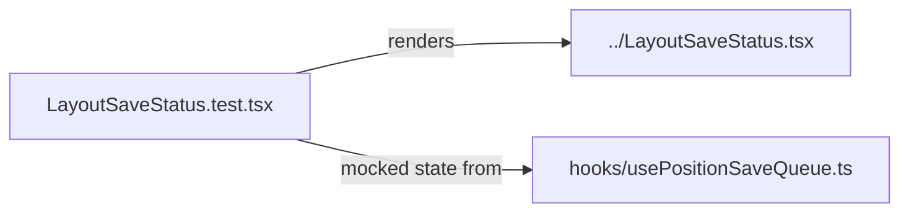

# `packages/web/src/components/__tests__/` — component tests

Holds one test file. Most component tests sit next to their component as
`*.test.tsx` in [`../`](../README.md); this folder has the test for the
layout-save indicator.



| Path | What it covers |
| --- | --- |
| [`LayoutSaveStatus.test.tsx`](LayoutSaveStatus.test.tsx) | The indicator never claims a save the server did not accept, keeps failures visible, offers discard for unsent edits, and stays passive (no tap target, no camera move) while a healthy save is in flight. |

## How to run / use

Vitest with jsdom and Testing Library, set up by [`../../test/setup.ts`](../../test/setup.ts):

```bash
npm run test -w @graphdone/web     # vitest --run --reporter=verbose (all web tests)
```

Up: [`components/`](../README.md)
