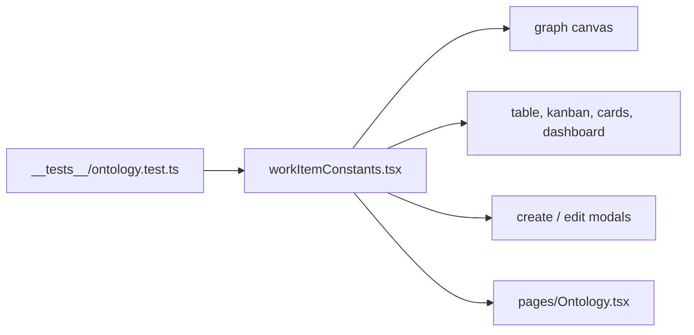

# `packages/web/src/constants/` — the item vocabulary

One large file (about 1,200 lines) that defines every work item type, status,
priority level and relationship type the UI knows, with its label, colours,
icon and description. About 35 files import it, so this is the single place to
change how a type or status looks or to add a new one.

## What's here

| Path | What it is |
| --- | --- |
| [`workItemConstants.tsx`](workItemConstants.tsx) | Types (`EPIC`, `MILESTONE`, `OUTCOME`, `FEATURE`, `TASK`, `BUG`, `IDEA`, `RESEARCH`, `REQUIREMENT`), nine statuses, priority levels mapped from 0–1 scores, and relationships (`DEPENDS_ON`, `BLOCKS`, `ENABLES`, `RELATES_TO`, `IS_PART_OF`, `FOLLOWS`, `PARALLEL_WITH`, `DUPLICATES`, `CONFLICTS_WITH`, `SATISFIES`). Lookup helpers (`getTypeConfig`, `getStatusConfig`, `getRelationshipConfig`...), dropdown option lists, contributor, due-date and project-health colours. |
| [`__tests__/`](__tests__/README.md) | Tests for the requirements additions. |

The server's own enums are in `packages/server/src/schema/neo4j-schema.ts`; a
new type or status has to be added there too.

Up: [`src/`](../README.md)
