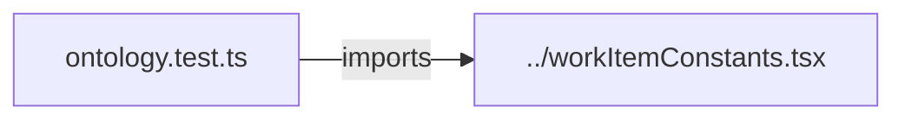

# `packages/web/src/constants/__tests__/` — vocabulary tests

Checks that the requirements-traceability additions to the item vocabulary are
wired in: the `REQUIREMENT` item type and the `SATISFIES` relationship.



| Path | What it covers |
| --- | --- |
| [`ontology.test.ts`](ontology.test.ts) | `REQUIREMENT` is a valid type with a config; `SATISFIES` is a valid relationship with a config; unknown relationship types are rejected. |

## How to run / use

```bash
npm run test -w @graphdone/web     # vitest --run --reporter=verbose (all web tests)
```

Up: [`constants/`](../README.md)
