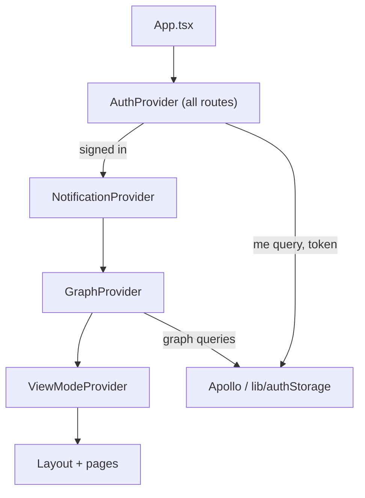

# `packages/web/src/contexts/` — app-wide state

React context providers for the state almost every screen needs: who is signed
in, which graph (project) is open, which view is showing, and toast
notifications. [`../App.tsx`](../App.tsx) wraps the app in them; components
read them with the matching `use...` hook (about 40 files use `useAuth` or
`useGraph`).

## What's here

| Path | What it is |
| --- | --- |
| [`AuthContext.tsx`](AuthContext.tsx) | `AuthProvider` / `useAuth`: restores the saved session from [`../lib/authStorage.ts`](../lib/authStorage.ts), confirms it with the `me` query, and exposes `currentUser`, `currentTeam`, `login`, `logout`, `isAuthenticated`. |
| [`GraphContext.tsx`](GraphContext.tsx) | `GraphProvider` / `useGraph`: the list of graphs the user can see, the current graph (remembered in `localStorage`), create/update/delete/duplicate/move, and sub-graph navigation (`descendInto`, `ascendTo`, breadcrumbs). A user who can see no graphs gets the example workspace from [`../lib/starterWorkspace.ts`](../lib/starterWorkspace.ts), with Welcome open; `addExampleProject` adds it again on request. Welcome opens only if the user has not picked a graph meanwhile, on this page, before a reload or in another tab. If a reload interrupts it, the next load finishes it: it waits for writes still in flight to land or time out (30 s), adds only what is missing, and removes empty duplicates a late write left. On the self-hosted server the unfinished parts are tagged `example:pending` on the server, so a sign-in in another browser finishes them too, once nothing has changed for 30 s. One tab at a time does this, through Web Locks or, on plain HTTP, [`../lib/storageLock.ts`](../lib/storageLock.ts). [`GraphContext.test.tsx`](GraphContext.test.tsx) runs the provider against an in-memory backend while the example is being written. A project that still has graphs cannot be deleted; the graphs inside are asked of the backend first, not read from this tab's list. A graph whose project is gone is listed at the top. Uses [`../graphql/graph.ts`](../graphql/graph.ts). |
| [`ViewModeContext.tsx`](ViewModeContext.tsx) | `ViewModeProvider` / `useViewMode`: graph, dashboard, table, cards, kanban, gantt, calendar or activity; saved as `graphdone:viewMode`. |
| [`NotificationContext.tsx`](NotificationContext.tsx) | `NotificationProvider` / `useNotifications`: `showSuccess` / `showError` toasts. |

The types for the auth and graph contexts are in [`../types/`](../types/README.md).

Up: [`src/`](../README.md)
