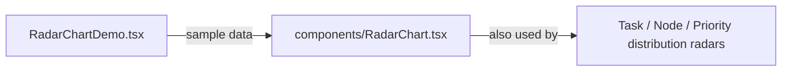

# `packages/web/src/examples/` — demo component

A standalone demo of the radar chart with sample data. It is not imported by
any page or route, so it never appears in the app; it is only a reference for
how to call [`../components/RadarChart.tsx`](../components/RadarChart.tsx).

| Path | What it is |
| --- | --- |
| [`RadarChartDemo.tsx`](RadarChartDemo.tsx) | Two radar charts (work by category, completion by category) with hard-coded values. |

Up: [`src/`](../README.md)
