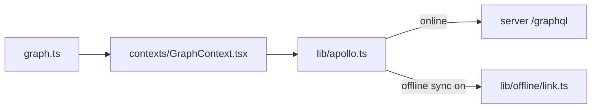

# `packages/web/src/graphql/` — graph (project) operations

GraphQL documents for graphs: the projects and sub-graphs a user opens. They
are used by [`../contexts/GraphContext.tsx`](../contexts/GraphContext.tsx).
Queries for work items, edges, users and the rest are in
[`../lib/queries.ts`](../lib/queries.ts).

| Path | What it is |
| --- | --- |
| [`graph.ts`](graph.ts) | In use: `GET_GRAPHS_BY_USER` (the graphs list), `CREATE_GRAPH`, `UPDATE_GRAPH`, `DELETE_GRAPH`. Defined but not used: `GET_GRAPHS` (imported, never called), `GET_GRAPHS_BY_TEAM`, `GET_GRAPH`, and the subscriptions `GRAPH_CREATED`, `GRAPH_UPDATED`, `GRAPH_DELETED` (the subscription code in `GraphContext.tsx` is commented out). |

The server-side types they query are in
[`packages/server/src/schema/neo4j-schema.ts`](../../../server/src/schema/neo4j-schema.ts).

Up: [`src/`](../README.md)
