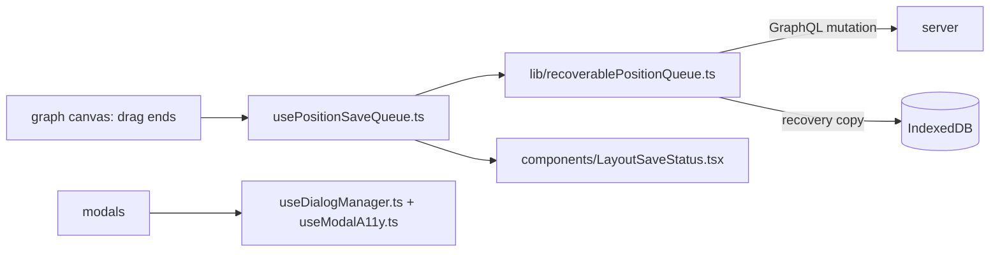

# `packages/web/src/hooks/` — reusable React hooks

Hooks shared by several components: one-dialog-at-a-time handling and modal
accessibility, saving dragged node positions safely, health and config checks
against the server, and screen-size and device-quality signals. The pure logic
behind several of them is in [`../lib/`](../lib/README.md); the hooks connect
it to React state.

## What's here

| Path | What it is |
| --- | --- |
| [`usePositionSaveQueue.ts`](usePositionSaveQueue.ts) | `PositionSaveProvider` (mounted in `App.tsx`), `usePositionSaveQueue` and `useLayoutRecovery`: one save queue per user and graph, so moved items are saved in order and retried. Unsent positions are also kept in IndexedDB (via `lib/layoutPersistence.ts`) so they survive a reload. |
| [`useDialogManager.ts`](useDialogManager.ts) | `DialogManager` / `useDialog`: only one pop-up is open at a time and Esc always closes the top one. |
| [`useModalA11y.ts`](useModalA11y.ts) | Dialog role and name, focus on open, Tab focus trap and focus return for modals. |
| [`useItemPresentation.ts`](useItemPresentation.ts) | Hands rendering between the zoomed-out overview and the item cards without a flash during zoom. |
| [`useAdaptiveQuality.ts`](useAdaptiveQuality.ts) | Live quality tier from device and network signals (wraps [`../lib/adaptiveQuality.ts`](../lib/adaptiveQuality.ts)); user override in Settings. |
| [`useCompactWorkspace.ts`](useCompactWorkspace.ts) | `true` on phone-sized screens; switches the workspace to its compact layout. |
| [`useHealthStatus.ts`](useHealthStatus.ts) | Fetches `/health` to tell whether the graph service (Neo4j) is available. |
| [`useHealthCheck.ts`](useHealthCheck.ts) | Detailed `/health` and `/mcp/status` check for the MCP indicator. |
| [`useSystemConfig.ts`](useSystemConfig.ts) | Reads `/config` (ports, TLS, OAuth) for the Admin page. |
| [`useTeamData.ts`](useTeamData.ts) | Team node queries; used only by the unrouted `pages/NodeList.tsx`. |
| [`useMcpServers.ts`](useMcpServers.ts) | MCP server detection; used only by the unused `components/McpServerCard.tsx`. |
| `useHealthStatus.test.ts`, `useItemPresentation.test.tsx`, [`__tests__/`](__tests__/README.md) | Vitest tests. |

Up: [`src/`](../README.md)
