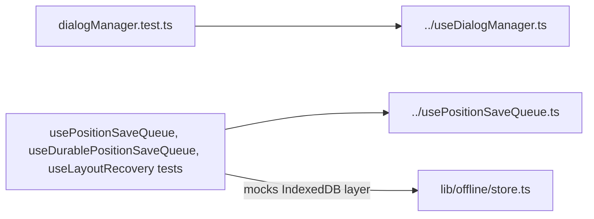

# `packages/web/src/hooks/__tests__/` — hook tests

Vitest tests for the dialog manager and the layout-saving hooks. The saving
tests matter most: they prove a moved item's position is never lost or sent to
the wrong graph or account, across navigation, outages, reloads and sign-out.
Two more hook tests sit next to their hooks in [`../`](../README.md).



| Path | What it covers |
| --- | --- |
| [`dialogManager.test.ts`](dialogManager.test.ts) | Exclusive vs stacked dialogs; Esc closes only the top one and reports when nothing was open. |
| [`usePositionSaveQueue.test.ts`](usePositionSaveQueue.test.ts) | Failed saves are kept across view changes, an outage is reported once and retried on reconnect, newer positions win, graphs never mix. |
| [`useDurablePositionSaveQueue.test.ts`](useDurablePositionSaveQueue.test.ts) | The newest unsent position survives the whole provider being replaced (a reload). |
| [`useLayoutRecovery.test.ts`](useLayoutRecovery.test.ts) | Recovered layouts stay scoped to the right account; discard and logout race safely. |

## How to run / use

Vitest with jsdom, set up by [`../../test/setup.ts`](../../test/setup.ts):

```bash
npm run test -w @graphdone/web     # vitest --run --reporter=verbose (all web tests)
```

Up: [`hooks/`](../README.md)
