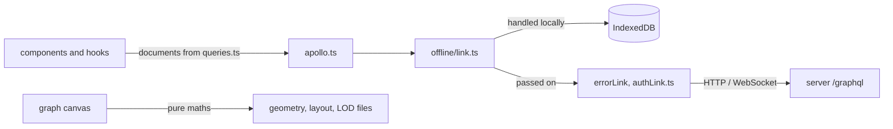

# `packages/web/src/lib/` — non-visual logic

The app's logic that is not a React component: how it talks to the server,
where it keeps session and layout data, and the pure geometry, layout and
level-of-detail maths behind the graph canvas. Most files are pure functions
with no DOM or D3, so they are unit-tested directly (see
[`__tests__/`](__tests__/README.md) and the `*.test.ts` files here).

## What's here

| Group | Files | What they do |
| --- | --- | --- |
| Server connection | [`apollo.ts`](apollo.ts), [`authLink.ts`](authLink.ts), [`apiUrl.ts`](apiUrl.ts), [`queries.ts`](queries.ts), [`operations.ts`](operations.ts), [`hostedUsage.ts`](hostedUsage.ts) | The Apollo client and its link chain (offline → error → auth → usage → HTTP; subscriptions over WebSocket); GraphQL documents for items, edges, users and OAuth provider settings; `/api/ops` requests; hosted usage meters and pausing background polling when idle. Start with `apollo.ts`. |
| Session and access | [`authStorage.ts`](authStorage.ts), [`roleAccess.ts`](roleAccess.ts), `loginCode.ts`, `loginFocus.ts`, `clipboard.ts` | Token and user storage ("keep me signed in" uses `localStorage`, otherwise `sessionStorage`); which roles may open Admin and Backend; the emailed sign-in code format; copy-to-clipboard and short ids. |
| Saving layout and undo | [`positionSaveQueue.ts`](positionSaveQueue.ts), [`recoverablePositionQueue.ts`](recoverablePositionQueue.ts), [`layoutPersistence.ts`](layoutPersistence.ts), `serialQueue.ts`, [`undoStack.ts`](undoStack.ts) | Coalesced, bounded writes of node positions with an IndexedDB recovery copy; per-key ordered tasks; the undo stack behind Ctrl/Cmd+Z. Used through `hooks/usePositionSaveQueue.ts`. |
| Canvas geometry | `edgeGeometry.ts`, `edgeRouteGeometry.ts`, `edgeLabelLayout.ts`, `edgeLabelPlacement.ts`, `edgeLOD.ts`, `parallelEdges.ts`, `schematicRouting.ts`, [`graphSymbolLayout.ts`](graphSymbolLayout.ts), `graphFit.ts`, `separateCards.ts`, `nodeControlIcons.ts` | Where edges meet cards, routed edge paths and their labels, how edges fade or bundle by zoom, card sizes and fonts, fitting the camera, untangling overlapping cards, header control icons. |
| Layout and simulation | `physicsConfig.ts`, `layoutAlgorithms.ts`, `topologyOrganization.ts`, `organizationCamera.ts`, `graphDataMerge.ts`, `graphAdjacency.ts` | Force-simulation settings, the optional layered (hierarchical) layout, "organize" arrangement and its camera, merging fresh data into the live simulation without losing positions, hover neighbourhoods. |
| Level of detail | [`semanticLOD.ts`](semanticLOD.ts), `semanticRelationships.ts`, `semanticTrace.ts`, `overviewOrganization.ts`, `overviewBusHint.ts`, `overviewBusHit.ts`, `localItemLOD.ts`, `localItemLayout.ts`, `subgraphPreview.ts` | Display-only projections for large graphs: grouped overview, relationship buses and traces, the readable local neighbourhood of a dense item, sub-graph previews. They never feed back into saved positions. Background: [`docs/architecture/`](../../../../docs/architecture/README.md). |
| Item data | `graphAnalytics.ts`, `recordedActivity.ts`, `statusNotes.ts`, `requirementsCoverage.ts`, [`relationshipPriority.ts`](relationshipPriority.ts), `connectionUtils.ts` | Analytics summaries, the activity list (only real timestamps and notes), status notes kept in item metadata, requirement coverage via `SATISFIES` edges, relationship priority levels, connection lookups. |
| Starter content | [`starterWorkspace.ts`](starterWorkspace.ts) | The example workspace a new user gets, and "Add example project": projects Getting started (Welcome, Plan a launch, Fix bugs, Ideas) and Home (Move house), each item at a fixed position; or the single Welcome graph when the backend cannot keep a hierarchy. `createStarterWorkspace` writes it through any backend: projects, then graphs, then items and connections. |
| Device and feel | [`adaptiveQuality.ts`](adaptiveQuality.ts), `perfMeter.ts`, `touchInteraction.ts`, `nodeAnimations.ts`, `celebration.ts` | Quality tiers from device and network, frame-time meters for the debug console, tap and touch-target rules, status-driven node animation classes, the completion burst. |
| Not used | `nodeTypeConfig.ts` | An older colour table for node types; nothing imports it (colours now come from `constants/workItemConstants.tsx`). |
| Tests here | 17 `*.test.ts(x)` files | Tests for the newer modules sit next to them (`semanticLOD.test.ts`, `localItemLOD.test.ts`, `topologyOrganization.test.ts`...). `routerNavigation.test.tsx` checks React Router navigation behaviour itself. |
| Subfolders | [`offline/`](offline/README.md), [`project-transfer/`](project-transfer/README.md), [`__tests__/`](__tests__/README.md) | Browser-local workspace and sync; project file import/export; unit tests. |

Up: [`src/`](../README.md)
