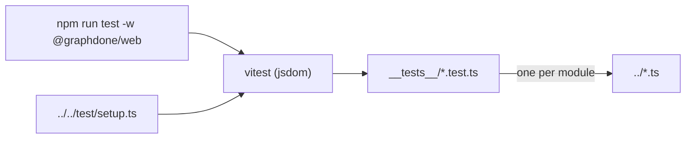

# `packages/web/src/lib/__tests__/` — unit tests for `lib/`

One test file per `lib/` module (34 files), named after the module it covers:
`edgeGeometry.test.ts` tests `../edgeGeometry.ts`, and so on. Because those
modules are pure functions, these tests run fast in Node/jsdom with no server,
and they pin down the geometry and saving rules the graph canvas relies on.
Tests for the newer level-of-detail modules sit next to their code in
[`../`](../README.md) instead.



## What's here

| Area | Test files |
| --- | --- |
| Server connection and session | `apiUrl`, `apolloErrors` (the Apollo error link), `authLink`, `authStorage`, `loginCode`, `loginFocus`, `clipboard` |
| Saving layout and undo | `positionSaveQueue`, `recoverablePositionQueue`, `layoutPersistence`, `undoStack` |
| Canvas geometry | `edgeGeometry`, `edgeRouteGeometry`, `edgeLabelLayout`, `edgeLabelPlacement`, `edgeLOD`, `parallelEdges`, `graphSymbolLayout`, `graphFit`, `separateCards` |
| Layout and simulation | `physicsConfig`, `layoutAlgorithms`, `graphDataMerge`, `graphAdjacency` |
| Item data | `graphAnalytics`, `recordedActivity`, `statusNotes`, `requirementsCoverage`, `relationshipPriority` |
| Device and feel | `adaptiveQuality`, `perfMeter`, `touchInteraction`, `nodeAnimations`, `celebration` |

Each name above is `<name>.test.ts` in this folder.

## How to run / use

```bash
npm run test -w @graphdone/web          # all web tests: vitest --run --reporter=verbose
npm run test:coverage -w @graphdone/web # with v8 coverage
```

Up: [`lib/`](../README.md)
