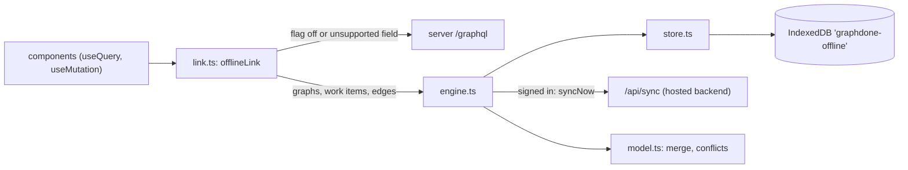

# `packages/web/src/lib/offline/` — browser-local workspace and sync

Lets GraphDone work with the data kept in the browser. When the app is built
with `VITE_OFFLINE_SYNC=true` (the hosted build at graphdone.com), an Apollo
link answers the graph's GraphQL operations from IndexedDB instead of the
server. Guests (`local-guest` token) never leave the device; signed-in users
edit locally and their changes are uploaded to `/api/sync` in the background,
with a three-way merge and a conflict prompt when both sides changed.
With the flag off (a normal self-hosted build) this folder does nothing and
every request goes to the GraphQL server.

## What's here

| Path | What it is |
| --- | --- |
| [`link.ts`](link.ts) | Start here. `offlineLink`, the first link in [`../apollo.ts`](../apollo.ts). Handles `graphs`, `workItems`, `workItem`, `edges`, their create/update/delete mutations, `restoreWorkItem`, `me` and `guestLogin`; everything else is forwarded. Shapes rows as the server's GraphQL types would. |
| [`engine.ts`](engine.ts) | Account and project state: `listProjects`, `getProject`, `syncNow` (one tab at a time via Web Locks), `resolveConflict`, `prepareOffline`, backup `exportOffline` / `importOffline`, `exportProject`. `useOffline` exposes status to the UI. |
| [`model.ts`](model.ts) | Pure data model: `Snapshot` (project, nodes, edges, notes), change detection, the three-way `merge`, upload requests and backup validation. |
| [`store.ts`](store.ts) | IndexedDB `graphdone-offline` (one record per account) and a `BroadcastChannel` so open tabs see each other's writes. |
| `link.test.ts`, `model.test.ts` | Vitest tests: the link answering GraphQL from a fixture account, and merge rules (no lost edits, conflicts kept until a person chooses). |

The `/api/sync` service is part of the hosted build, not of
[`packages/server/`](../../../../server/README.md); in development Vite proxies
it to port 8797. The status UI is `components/OfflineStatus.tsx` and
`components/MobileStorageStatus.tsx`; the service worker that caches the app
itself is built by `packages/web/offline-shell.ts`.

Up: [`lib/`](../README.md)
