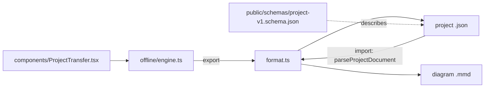

# `packages/web/src/lib/project-transfer/` — project file format

Turns a project into a file people can keep or move, and back again. A project
exported here is a `graphdone-project` version 1 JSON document; it can also be
exported as a Mermaid diagram for reading (not for re-import). Only an explicit
allowlist of fields is written, so tokens, account ids and sync internals never
leave the browser.

## What's here

| Path | What it is |
| --- | --- |
| [`format.ts`](format.ts) | `projectDocument` (snapshot to JSON), `parseProjectDocument` (validates and normalises an imported file), `projectMermaid`, `projectFilename`, `downloadText`. |
| [`format.test.ts`](format.test.ts) | Round trips without sync state or credentials, empty and cyclic projects, the full supported size, safe Mermaid labels and ids, safe filenames. |
| [`schema.test.ts`](schema.test.ts) | The published JSON Schema accepts the documented example and a real export, and rejects other versions. |

The format is documented in
[`docs/formats/PROJECT_TRANSFER.md`](../../../../../docs/formats/PROJECT_TRANSFER.md);
its schema is served from [`public/schemas/project-v1.schema.json`](../../../public/schemas/project-v1.schema.json).
Export and import go through [`../offline/engine.ts`](../offline/engine.ts) and
work on the browser-local workspace, so the buttons in `ProjectTransfer.tsx`
only appear when the app is built with `VITE_OFFLINE_SYNC=true`.

Up: [`lib/`](../README.md)
