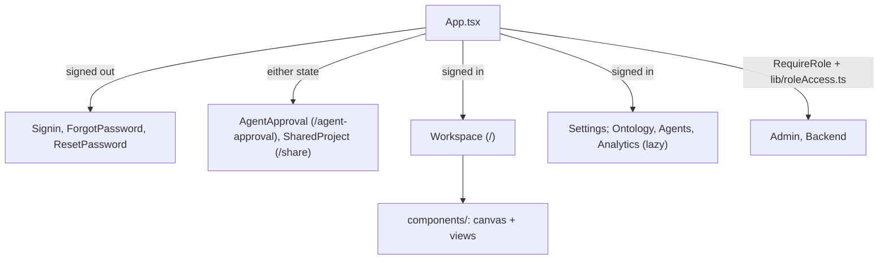

# `packages/web/src/pages/` — one component per route

The screens of the app. [`../App.tsx`](../App.tsx) maps URLs to these
components: signed-out visitors only reach the sign-in pages; signed-in users
get the rest inside the [`Layout`](../components/Layout.tsx) shell. Rarely used
pages (Ontology, Agents, Analytics, Admin, Backend) are lazy-loaded, so they
are split out of the main bundle.

## What's here

| Path | Route | What it is |
| --- | --- | --- |
| [`Workspace.tsx`](Workspace.tsx) | `/`, `/workspace` | Start here. The main screen: graph canvas or list views for the current graph, item inspector, minimap, create/graph modals, phone controls. |
| [`Signin.tsx`](Signin.tsx) | `/`, `/login`, `/signup` (signed out) | Password, magic-link and emailed-code sign-in, OAuth buttons for providers listed in `/config`, guest entry, CAPTCHA. |
| [`ForgotPassword.tsx`](ForgotPassword.tsx), [`ResetPassword.tsx`](ResetPassword.tsx) | `/forgot-password`, `/reset-password` | Request and complete a password reset. |
| [`Ontology.tsx`](Ontology.tsx) | `/ontology` | Reference of item types, statuses and relationships, with requirements coverage. |
| [`Agents.tsx`](Agents.tsx) | `/agents` | Connect an AI agent and see the work agents have recorded. |
| [`Analytics.tsx`](Analytics.tsx) | `/analytics` | Summaries and charts of the current graph. |
| [`Settings.tsx`](Settings.tsx) | `/settings` | Quality tier, storage and usage, layout recovery, feedback, version. |
| [`Admin.tsx`](Admin.tsx) | `/admin` (`ADMIN` only) | Tabs: feedback and operations, users, registration, OAuth providers, database, security, backup. |
| [`Backend.tsx`](Backend.tsx) | `/backend` (not `GUEST` or `VIEWER`) | Service status page: checks `/health` and makes test GraphQL requests. |
| [`AgentApproval.tsx`](AgentApproval.tsx) | `/agent-approval` | Approve or reject an agent's email enrollment. Calls `/api/enrollment`. |
| [`SharedProject.tsx`](SharedProject.tsx) | `/share` | Open a project from a share link. Calls `/api/share`. |
| [`Signin.captcha.test.tsx`](Signin.captcha.test.tsx) | | Vitest: sign-in never submits without a valid CAPTCHA proof and clears a used proof. |
| `GraphManagement.tsx`, `GraphView.tsx`, `NodeList.tsx` | none | Older pages that no route uses. |

`/api/enrollment` and `/api/share` are provided by the hosted build's backend;
[`packages/server/`](../../../server/README.md) does not serve them (it has its
own `/share/*` routes).

Up: [`src/`](../README.md)
