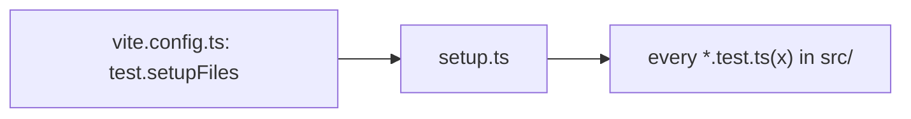

# `packages/web/src/test/` — Vitest setup

Shared setup that runs before every web unit test. It exists so each test file
does not have to repeat it.



| Path | What it is |
| --- | --- |
| [`setup.ts`](setup.ts) | Adds the `jest-dom` matchers (`toBeInTheDocument` and friends) to Vitest's `expect`, and unmounts Testing Library renders after each test. |

Tests run in jsdom (set in [`../../vite.config.ts`](../../vite.config.ts)):

```bash
npm run test -w @graphdone/web     # vitest --run --reporter=verbose
```

Up: [`src/`](../README.md)
