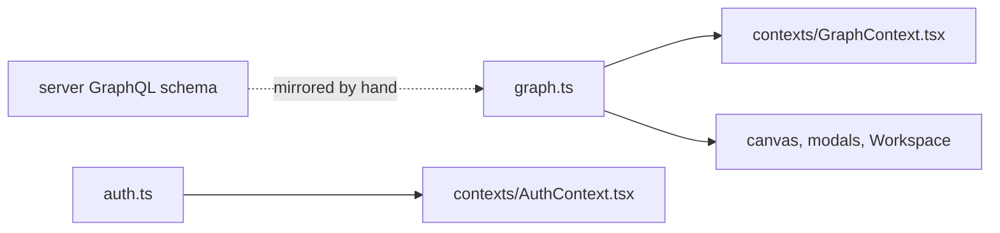

# `packages/web/src/types/` — shared TypeScript types

The shapes of the data the UI passes around: graphs (projects), work items,
edges, users and teams, plus the types of the auth and graph contexts. They
mirror the GraphQL types in
[`packages/server/src/schema/`](../../../server/src/schema/README.md) but are
written by hand, so a schema change has to be copied here.

## What's here

| Path | What it is |
| --- | --- |
| [`graph.ts`](graph.ts) | `Graph`, `GraphPermissions`, `ShareSettings`, `GraphSettings`, `GraphHierarchy`, `WorkItem`, `WorkItemEdge`, `RelationshipType`, `CreateGraphInput`, `GraphContextType`. Used by about ten files. |
| [`auth.ts`](auth.ts) | `User` (roles `GUEST`, `VIEWER`, `USER`, `ADMIN`), `Team`, `AuthContextType`. |
| [`projectData.ts`](projectData.ts) | Mock nodes and edges with relationship descriptions. Not imported anywhere. |

Item type, status and relationship labels and colours are not types; they live
in [`../constants/`](../constants/README.md).

Up: [`src/`](../README.md)
