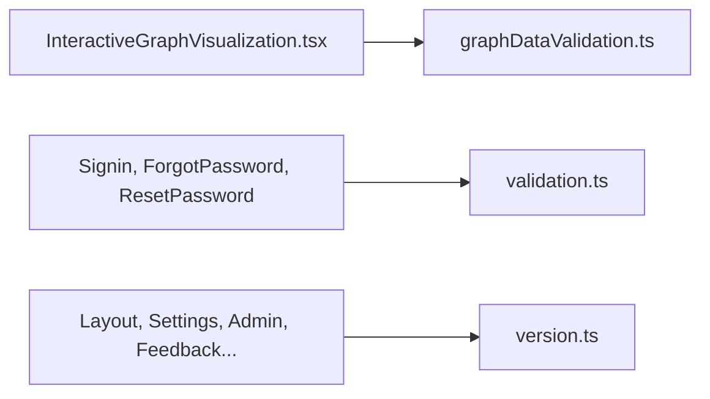

# `packages/web/src/utils/` — small helpers

A handful of standalone helpers that predate [`../lib/`](../lib/README.md):
checking graph data before the canvas draws it, form validation for the
sign-in pages, and the version string shown in the UI.

## What's here

| Path | What it is |
| --- | --- |
| [`graphDataValidation.ts`](graphDataValidation.ts) | `validateGraphData` and `getValidationSummary`: finds bad nodes and edges (missing fields, duplicate ids, out-of-range numbers, invalid edge types, edges to missing nodes) and reports errors and warnings instead of letting the canvas crash. |
| [`validation.ts`](validation.ts) | `isValidEmail`, `validatePassword`, `getPasswordStrength` for the sign-in and reset forms. |
| [`version.ts`](version.ts) | `APP_VERSION`, a hard-coded copy of the root `package.json` version; `scripts/update-version-minimal.sh` updates it and `tests/toolchain/version-contract.mjs` checks it. |
| [`nodeColorSystem.ts`](nodeColorSystem.ts) | Marked deprecated in its header and imported nowhere; colours now come from [`../constants/workItemConstants.tsx`](../constants/workItemConstants.tsx). |

Up: [`src/`](../README.md)
