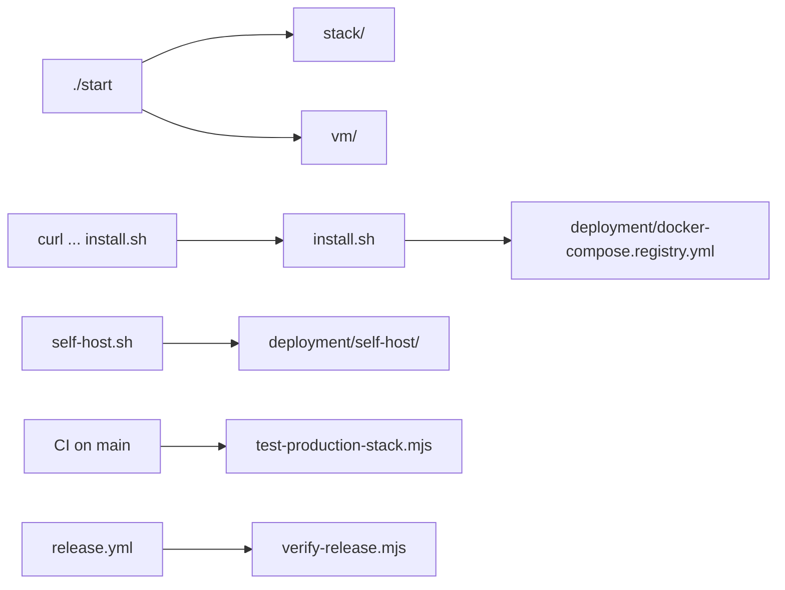

# `scripts/` — installers, stack control and release checks

Shell and Node scripts run from the repository root. Most people only meet them
through `./start` (which calls [`stack/`](stack/README.md)), the one-line installer
or `./scripts/self-host.sh`. Test suites live in [`tests/`](../tests/README.md), not
here; the scripts below that start with `test-` are probes and gates that CI or a
person runs against a real stack.

| Path | What it is |
| --- | --- |
| [`stack/`](stack/README.md) | Local stack lifecycle behind `./start`: setup, run, build, test, deploy, cleanup |
| [`vm/`](vm/README.md) | Multipass VM launch, base image and VM end-to-end runs |
| `install.sh` | Public one-line installer (`curl … /main/scripts/install.sh \| sh`) |
| `setup_docker.sh`, `setup_git.sh`, `setup_nodejs.sh` | Prerequisite installers; `install.sh` and `./start` call them by these paths, so they stay here |
| `setup-mcp.sh`, `setup-oauth.sh` | One-off developer setup |
| `manage-certificates.sh` (`generate-dev-certs.sh` links to it), `generate-ssl-certs.sh`, `generate-multi-host-certs.sh`, `test-tls.sh` | Development TLS certificates |
| `self-host.sh` | Source-based self-host install (see `deployment/self-host/`) |
| `test-installation-simple.sh`, `generate-clean-report.sh`, `fresh-test.sh`, `verify-fresh.sh`, `github-actions-test.sh` | Installer and fresh-checkout checks |
| `render-schematic-routing.mjs`, `narrate-report.mjs` | Report generators behind `npm run report:schematic` / `dashboard:narrate` |
| `dashboard-loop.sh`, `dashboard-loop.prompt.txt`, `install-dashboard-service.sh`, `graphdone-triage.mjs`, `dogfood-cycle2.mjs` | Improvement loop and live dashboard service |
| `test-operations-local.mts`, `test-admin-bootstrap.mts`, `test-codex-connection.mjs`, `test-gateway-triage.mjs`, `testing/` | Local operator and connection probes |
| `test-production-stack.mjs` | The production-stack smoke CI runs when `main` is involved: starts `deployment/docker-compose.yml` with throwaway certificates, runs the unified `prod-smoke` sequence and the SQLite persistence check, then tears it all down |
| `test-sqlite-container-persistence.mjs` | Proves accounts in the API container's SQLite survive recreating the container |
| `verify-release.mjs` | The release gate `release.yml` runs on a `v*` tag: the tag must be a `main` commit whose CI passed and whose versions match |
| `init-db.sql`, `update-version-minimal.sh` | Database init and version bump helpers |

Up: [repository root](../README.md)
