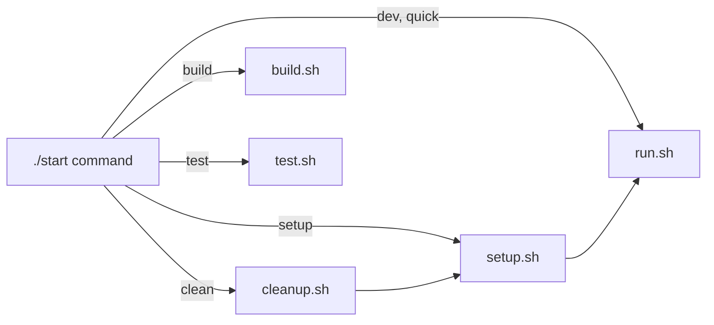

# `scripts/stack/` — local stack lifecycle

The scripts behind `./start` at the repository root. `./start` picks one or more
of them for each command; you can also run them directly from the repository root.

## What's here

| Script | Used by |
| --- | --- |
| [`setup.sh`](setup.sh) | `./start setup`, `dev`, `clean`: install dependencies and build `@graphdone/core` |
| [`run.sh`](run.sh) | `./start dev`, `quick`, `clean`, `deploy`: start the servers locally or in Docker (`--docker`, `--docker-dev`) |
| [`build.sh`](build.sh) | `./start build` |
| [`test.sh`](test.sh) | `./start test` |
| [`cleanup.sh`](cleanup.sh) | `./start clean`: stop stray processes before a fresh setup |
| [`deploy.sh`](deploy.sh) | Run directly; staging/production deploy helper |

Docker modes use the compose files in [`deployment/`](../../deployment/README.md).

Up: [`scripts/`](../README.md)
