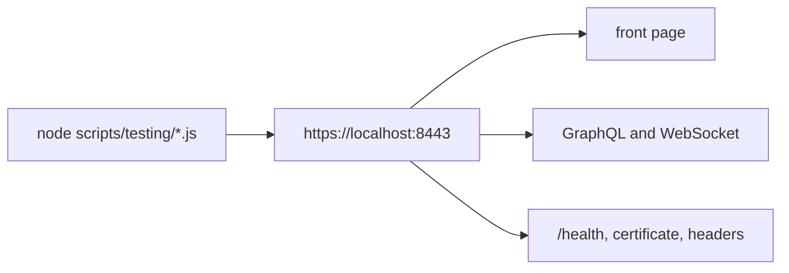

# `scripts/testing/` — manual HTTPS spot checks

Two small Node scripts for checking a local HTTPS deployment by hand. They call
`https://localhost:8443` with certificate checks turned off, so they only suit a
local stack with a self-signed certificate. No npm script or CI job runs them;
the automated suites live in [`tests/`](../../tests/README.md).

## What's here

| File | What it checks |
| --- | --- |
| [`test-browser-access.js`](test-browser-access.js) | The main page, a GraphQL request and a WebSocket upgrade through the HTTPS proxy, as a browser would make them |
| [`test-tls-admin-features.js`](test-tls-admin-features.js) | What the admin page relies on: `/health`, GraphQL, the front page, certificate details, WebSocket upgrade and security headers |

Run one with `node scripts/testing/test-browser-access.js` while the HTTPS stack is up.

Up: [`scripts/`](../README.md)
