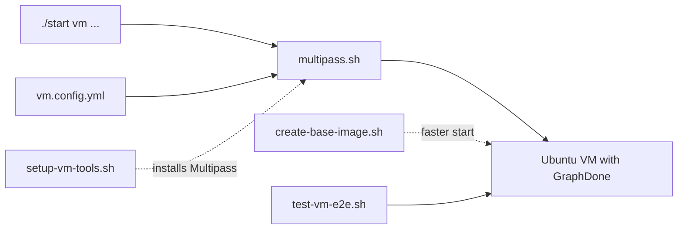

# `scripts/vm/` — Multipass VMs

Run GraphDone inside a throwaway Ubuntu VM, so you can test a fresh install
without touching your own machine. `./start vm …` passes its arguments to
`multipass.sh`. The [VM setup guide](../../docs/guides/vm-setup.md) walks through it.
Run from the repository root.

| File | What it is |
| --- | --- |
| [`multipass.sh`](multipass.sh) | Launch, shell, stop and delete VMs (`./start vm …`) |
| [`vm.config.yml`](vm.config.yml) | Defaults read by `multipass.sh`: name, resources, image, Tailscale, Node.js, checkout |
| `setup-vm-tools.sh` | Install Multipass and `yq` on the host |
| `create-base-image.sh` | Build a reusable base VM |
| `test-vm-e2e.sh`, `generate-test-manifest.sh` | Full end-to-end run inside a fresh VM, and its JSON manifest |

Secrets such as `TAILSCALE_AUTH_KEY` go in the gitignored root `.env`
(see `.env.example`), never in `vm.config.yml`.

Up: [`scripts/`](../README.md)
