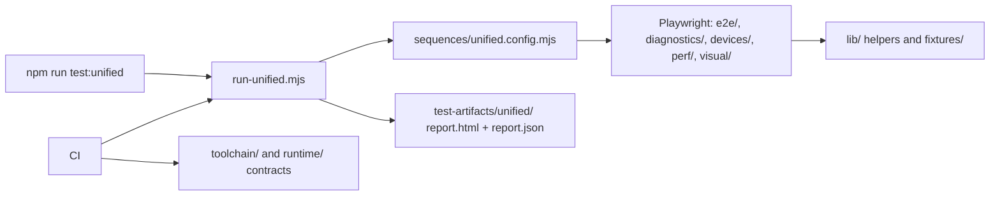

# GraphDone tests

Run commands from the repository root. The canonical guide is
[Testing](../docs/testing/README.md); it describes the acceptance profiles,
evidence format, and their limits.

| Command | What it verifies |
| --- | --- |
| `npm test` | Package unit suites through Turbo; does not run browser acceptance. |
| `npm run test:unified:lib` | Report adapters, process outcomes, CLI safety, source provenance, and dashboard helpers. No browser or database required. |
| `npm run test:installer` | One-line installer: every ref it uses is `main` or the `GRAPHDONE_REF` override, image tags are `latest` or versions, and in a disposable container it clones, updates and reaches its setup-script URLs. Needs Docker. |
| `TEST_URL=http://localhost:3127 npm run test:smoke` | Focused user smoke against an already-running disposable stack. |
| `TEST_URL=http://localhost:3127 npm run test:unified:smoke` | Web unit tests, user smoke, and focused authentication acceptance, with one combined report. |
| `TEST_URL=http://localhost:3127 npm run test:pr` | Broader graph, mobile, and performance sequences. |

Browser suites create, edit, and delete data. Start an owned disposable local
stack with test accounts and seeded data before running them. Never point the
ordinary smoke/PR suites at production or a shared developer database. Supplying
`TEST_URL` tells Playwright the stack is externally managed; it does not provision
or isolate that stack. Database-backed MCP suites additionally require their
explicit disposable-fixture configuration; see
[the MCP guide](../packages/mcp-server/README.md).

## How the folders fit together

`tests/run-unified.mjs` is the single entry for browser and package suites: it
runs the sequences named in [`sequences/`](sequences/README.md), which call
Playwright projects and the package unit tests, and writes one HTML + JSON report.
The repository contracts in `toolchain/` run with `npm run test:toolchain`; the
image contracts in `runtime/` run in CI's `runtime-images` job against a built image.



| Folder | What it holds |
| --- | --- |
| [`e2e/`](e2e/README.md) | Browser user workflows by domain; `e2e/smoke/user-smoke.spec.ts` is the focused gate, `e2e/journeys/` measures reliability per path and device |
| [`lib/`](lib/README.md) | Reusable helpers (auth, API, seeding) and the unified harness: reporting, adapters, runner |
| [`sequences/`](sequences/README.md) | Profile and sequence definitions for the harness |
| [`devices/`](devices/README.md) | UI fit gate: every screen on iPhone, iPad and desktop |
| [`diagnostics/`](diagnostics/README.md) | Graph geometry, layout, physics and inspector measurements |
| [`perf/`](perf/README.md) | Performance budgets and the scale sweep |
| [`visual/`](visual/README.md) | Schematic wire-routing checks, with their own Playwright config |
| [`integration/`](integration/README.md) | Installer, TLS and captcha checks outside the default browser project |
| [`toolchain/`](toolchain/README.md) | Repository contracts: root allowlist, public content, versions, Mermaid |
| [`runtime/`](runtime/README.md) | Production image contract |
| [`agents/`](agents/README.md) | Helpers for driving real AI agent CLIs in tests |
| [`fixtures/`](fixtures/README.md) | Static test data |

Single-purpose Playwright configs sit beside their specs
(`visual/playwright.schematic.config.ts`, `integration/playwright.captcha.config.ts`);
the default `playwright.config.ts` stays at the repo root.

An authenticated test under `tests/e2e/<domain>/` imports helpers with:

```ts
import { login, navigateToWorkspace, TEST_USERS } from '../../lib/auth';
```

Use the current helper and fixture configuration as the source of test account
details. A successful unit run or test listing is not evidence that a browser
workflow works. Report skipped, flaky, failed, and untested behavior explicitly.

Up: [repository root](../README.md)
