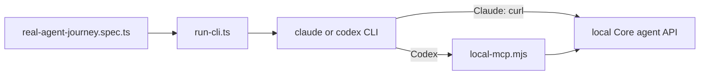

# `tests/agents/` — real AI agent CLI helpers

Helpers that let a browser test hand a GraphDone project to a real command-line
AI agent (Claude Code or Codex) and see what it does with it. Only
[`e2e/quality/real-agent-journey.spec.ts`](../e2e/quality/README.md) uses them, and
that spec skips unless `QC_REAL_AGENTS=1` is set, so normal runs never spend
inference credits.



## What's here

| Path | What it is |
| --- | --- |
| [`run-cli.ts`](run-cli.ts) | `runAgent(provider, prompt)`: starts `claude` or `codex` in an empty temporary folder with a small model, a spending cap (Claude) or a read-only sandbox (Codex) and a 3-minute kill timer. Agent tokens are redacted from the output it returns. |
| [`local-mcp.mjs`](local-mcp.mjs) | A test-only MCP server (stdio) for Codex with three tools: `graphdone_context`, `graphdone_update` and `graphdone_note`. It only talks to `localhost:3127/api/agent` and stops after 20 calls. |

## How to run

```bash
QC_REAL_AGENTS=1 TEST_URL=http://localhost:3127 npm run qc:real-agents
```

The spec refuses any target other than a local Core on port 3127.

Up: [`tests/`](../README.md)
