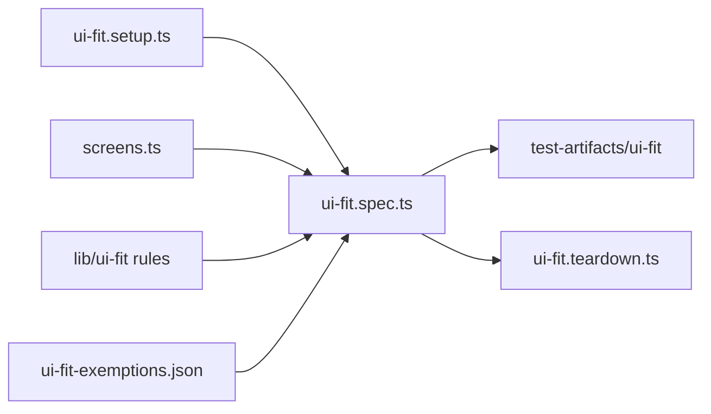

# `tests/devices/` — UI fit gate

Checks every visible control on every screen on iPhone, iPad and desktop
Chrome/Safari: accessible name, pointer-only clickables, centre hit, label fit and
contrast, icon centring, target size and sideways scroll. The Playwright projects
(`ui-fit-setup`, one `ui-fit:<device>` per device, `ui-fit-teardown`) come from
[`tests/lib/ui-fit/devices.mjs`](../lib/ui-fit/README.md). The rules are explained in
the [UI fit guide](../../docs/quality/UI_FIT.md).

## What's here

| Path | What it is |
| --- | --- |
| [`screens.ts`](screens.ts) | `UI_FIT_SCREENS`: sign-in, every workspace view (graph, dashboard, table, cards, kanban, gantt, calendar, activity), every page (settings, agents, analytics, ontology, admin, backend) and graph states such as connections, card peek, quick edit and create item. Add new screens and dialogs here. |
| [`ui-fit.setup.ts`](ui-fit.setup.ts) | Signs in once as the admin test user, creates a small connected "UI fit connections" graph and saves the login for every device project. |
| [`ui-fit.spec.ts`](ui-fit.spec.ts) | One test per screen (`<screen> fits`). Measures controls with `collect.mjs`, judges them with `rules.mjs` and writes JSON plus an annotated screenshot per device and screen to `test-artifacts/ui-fit/`. |
| [`ui-fit.teardown.ts`](ui-fit.teardown.ts) | Deletes the connected fixture graph. |
| [`ui-fit-exemptions.json`](ui-fit-exemptions.json) | Findings that are right by design, each with a reason a reviewer can check. Known bugs never go here. |

## How to run

- `npm run test:devices` runs every `ui-fit:*` project, then builds the gallery
  with `node tests/lib/ui-fit/report.mjs`.
- `node tests/run-unified.mjs --sequence devices` runs the blocking `devices`
  sequence (also in the `pr` and `full` profiles). The CI job
  "UI Fit (iPhone, iPad, desktop)" runs this sequence.

Up: [`tests/`](../README.md)
