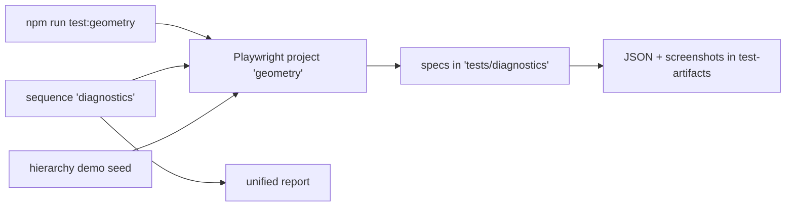

# `tests/diagnostics/` — graph geometry diagnostics

Measuring specs that look at the real rendered page: node and edge geometry, layout
balance, physics settling, hierarchy navigation, the inspector and a few small UI
parts. The whole folder is the test directory of the `geometry` Playwright project.
Most specs write screenshots and JSON under `test-artifacts/` so a layout problem
can be seen before and after a fix. The `diagnostics` sequence is report-only
(not blocking).



## What's here

| Path | What it is |
| --- | --- |
| [`hierarchy/`](hierarchy/README.md) | Graphs-of-graphs: the explorer tree and drilling into sub-graphs. |
| [`inspector/`](inspector/README.md) | The docked node inspector and its Card, Contents and Diagram modes. |
| [`interactions/`](interactions/README.md) | Basic user actions on the graph, checked from the DOM. |
| [`layout/`](layout/README.md) | Edge attachment, label fit and OpenCV balance metrics. |
| [`perf/`](perf/README.md) | Frame-rate profile of the 1000-node example graph. |
| [`physics/`](physics/README.md) | The layout settles, then stays still. |
| [`ui/`](ui/README.md) | Captcha layout, legibility floor, minimap zoom and the HTTP warning banner. |

Specs that open the "System Overview" or its sub-graphs need the hierarchy demo,
created by the `create-hierarchy-demo` script of the server package. Tests are
tagged `@geometry`, except the balance spec (`@balance`).

## How to run

```bash
npm run test:geometry                                  # the geometry project
node tests/run-unified.mjs --sequence diagnostics      # same, into the unified report
```

The `diagnostics` sequence is part of the `full` and `report` profiles, so
`npm run test:unified` includes it; its cases land in
`test-artifacts/unified/report.html`. Each spec also writes its own measurements to
a folder under `test-artifacts/` (named in the subfolder READMEs). Start with
[`interactions/`](interactions/README.md) for the broadest "does the graph work" check.

Up: [`tests/`](../README.md)
