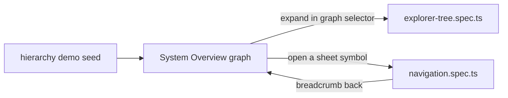

# `tests/diagnostics/hierarchy/` — graphs-of-graphs navigation

Checks that a person can move between a parent graph and its sub-graphs. Both specs
open the "System Overview" graph from the seeded hierarchy demo and run in the
`geometry` Playwright project.

## What's here

| Path | What it is |
| --- | --- |
| [`explorer-tree.spec.ts`](explorer-tree.spec.ts) | The graph selector expands "System Overview" to show its sub-graphs, and choosing one switches the current graph. |
| [`navigation.spec.ts`](navigation.spec.ts) | A sheet-symbol node opens its sub-graph and a breadcrumb goes back up. Hard assertions on both steps, plus screenshots in `test-artifacts/hierarchy/`. |

Run with `npm run test:geometry` (see [`diagnostics/`](../README.md)).

Up: [`tests/diagnostics/`](../README.md)
