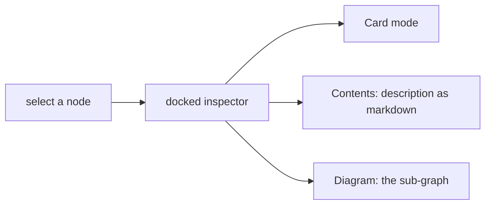

# `tests/diagnostics/inspector/` — docked node inspector

Checks the inspector panel that opens when a node is selected. The spec opens the
"System Overview" graph from the seeded hierarchy demo and runs in the `geometry`
Playwright project.

## What's here

| Path | What it is |
| --- | --- |
| [`node-inspector.spec.ts`](node-inspector.spec.ts) | Selecting a node opens the inspector; Contents shows the description as readable markdown, Diagram draws the sub-graph, and modes change only when the person picks one (not when zooming). |

Run with `npm run test:geometry` (see [`diagnostics/`](../README.md)).

Up: [`tests/diagnostics/`](../README.md)
