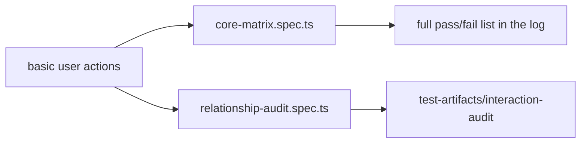

# `tests/diagnostics/interactions/` — basic graph interactions

Checks the everyday things a person does on the graph and asserts the right result
from the rendered DOM. Each check is named after the user action it guards. Both
specs run in the `geometry` Playwright project.

## What's here

| Path | What it is |
| --- | --- |
| [`core-matrix.spec.ts`](core-matrix.spec.ts) | "All basic user checks" on the signed-in user's current graph: node and edge create/edit/delete, selection and inspector, inline rename, drag (the open edit box follows), relationship type change and flip, plus invariants such as one arrow per edge. Collects every failure, then fails once with the whole list. |
| [`relationship-audit.spec.ts`](relationship-audit.spec.ts) | Seeds its own `[E2E]` graph. Changing a relationship type updates the label without a reload, and flipping a direction leaves exactly one edge for the pair. Writes `report.json` and screenshots. |

Run with `npm run test:geometry` (see [`diagnostics/`](../README.md)).

Up: [`tests/diagnostics/`](../README.md)
