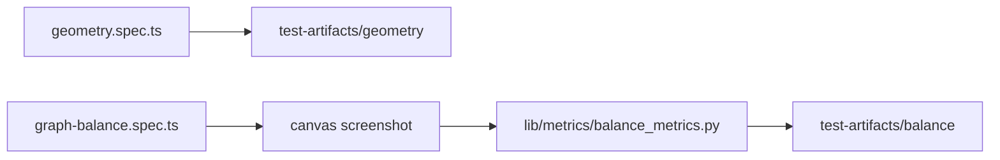

# `tests/diagnostics/layout/` — layout geometry and balance

Measures how the graph is laid out on screen, from the rendered DOM and from a
screenshot. Both specs run in the `geometry` Playwright project.

## What's here

| Path | What it is |
| --- | --- |
| [`geometry.spec.ts`](geometry.spec.ts) | Seeds its own `[E2E]` graph and measures edge attachment (centre or border), whether each edge label fits between its cards, and minimum edge length. A second test checks that dragging cannot pull a node closer than the label minimum. Writes `report.json` and screenshots. |
| [`graph-balance.spec.ts`](graph-balance.spec.ts) | Screenshots the graph canvas at desktop, laptop and tablet sizes and runs the OpenCV script in [`tests/lib/metrics/`](../../lib/metrics/README.md). Fails if the graph centre is far off the frame centre or the graph covers too little of the canvas. Tagged `@balance`; needs Python with OpenCV. |

Run with `npm run test:geometry` (see [`diagnostics/`](../README.md)).

Up: [`tests/diagnostics/`](../README.md)
