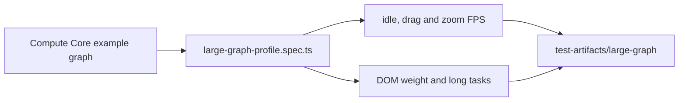

# `tests/diagnostics/perf/` — large-graph profile

A report-only frame-rate profile of the 1000-node "Compute Core" example graph from
the seeded hierarchy demo. It runs in the `geometry` Playwright project. The
performance budget gate lives in [`tests/perf/`](../../perf/README.md) instead.

## What's here

| Path | What it is |
| --- | --- |
| [`large-graph-profile.spec.ts`](large-graph-profile.spec.ts) | One test per visual-quality tier: measures idle, drag and zoom frame rate, a DOM-weight breakdown and long-task samples, and writes one JSON file. |

Run with `npm run test:geometry` (see [`diagnostics/`](../README.md)).

Up: [`tests/diagnostics/`](../README.md)
