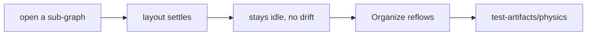

# `tests/diagnostics/physics/` — layout settling

Checks the one-shot layout model: a graph settles, then the simulation goes idle and
stays idle, and the manual Organize action re-settles a piled-up graph. It runs in
the `geometry` Playwright project and needs the seeded hierarchy demo.

## What's here

| Path | What it is |
| --- | --- |
| [`settle.spec.ts`](settle.spec.ts) | Records the full `window.__layoutMetrics` time series while the graph settles, rests and reflows. Uses a mid-size demo sub-graph; set `PHYS_GRAPH_ID` to measure another one. |

Run with `npm run test:geometry` (see [`diagnostics/`](../README.md)).

Up: [`tests/diagnostics/`](../README.md)
