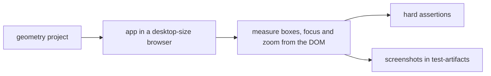

# `tests/diagnostics/ui/` — small UI diagnostics

Focused checks of single UI parts, measured from the rendered page. All four run in
the `geometry` Playwright project; some write screenshots under `test-artifacts/`.

## What's here

| Path | What it is |
| --- | --- |
| [`captcha-layout.spec.ts`](captcha-layout.spec.ts) | The captcha "Try different style" button is vertically centred against the challenge, with and without the speaker button. |
| [`legibility-floor.spec.ts`](legibility-floor.spec.ts) | The expand icon on a card opens a readable Card/Contents/Diagram peek anchored to the node; a card title stays at least 12 px on screen when zoomed out. Needs the hierarchy demo. |
| [`minimap-zoom.spec.ts`](minimap-zoom.spec.ts) | A mouse wheel over the minimap zooms the main graph view. Needs the hierarchy demo. |
| [`tls-banner.spec.ts`](tls-banner.spec.ts) | Over plain HTTP the insecure-connection banner is a slim top strip that reserves its own space, never covers the app and can be dismissed. |

Run with `npm run test:geometry` (see [`diagnostics/`](../README.md)).

Up: [`tests/diagnostics/`](../README.md)
