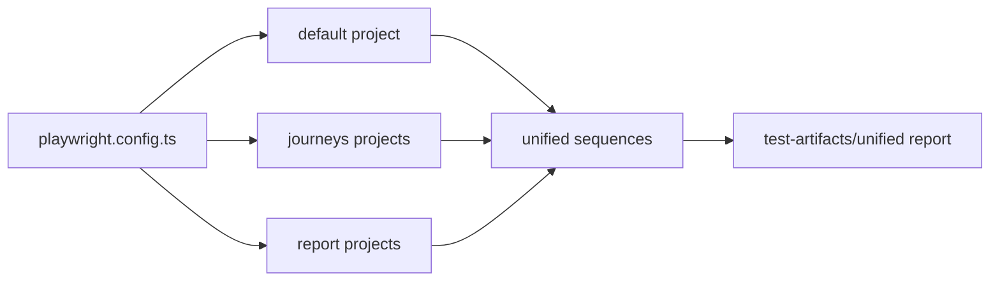

# `tests/e2e/` — browser user workflows

Playwright specs that drive the real web app like a person, grouped by domain.
`tests/e2e` is the root `testDir` in [`playwright.config.ts`](../../playwright.config.ts).
The default project, `GraphDone-Core/dev-neo4j/chromium`, collects every spec here
except `reports/` and `journeys/`, which have their own projects. Named sequences in
[`tests/sequences/`](../sequences/README.md) pick specs out of it for the gates.



## What's here

| Path | What it is |
| --- | --- |
| [`smoke/`](smoke/README.md) | The smoke gate: "a real user can use the app". Start here. |
| [`auth/`](auth/README.md) | Sign-in focus, form validation, route compatibility. |
| [`graph/`](graph/README.md) | The graph canvas: camera, level of detail, wires, quick edit, layout recovery. |
| [`journeys/`](journeys/README.md) | Basic user journeys with a success rate per path and device. |
| [`quality/`](quality/README.md) | Headed acceptance runs of whole tasks (new user, personas, agents, offline). |
| [`mobile/`](mobile/README.md) | Phone audits tagged `@mobile` / `@audit`. |
| [`responsive/`](responsive/README.md) | Login and workspace at five screen sizes. |
| [`ui/`](ui/README.md) | Overlays close properly and paint on top. |
| [`a11y/`](a11y/README.md) | Modal focus trap and restore. |
| [`api/`](api/README.md) | GraphQL and health endpoint checks. |
| [`admin/`](admin/README.md) | Admin panel Database and OAuth tabs. |
| [`reports/`](reports/README.md) | Capture-heavy, report-only galleries (matrix, showcase, live site, VLM). |

## How to run

Start a disposable local stack first (see [`tests/`](../README.md)):
```bash
TEST_URL=http://localhost:3127 npm run test:smoke       # the gate only
TEST_URL=http://localhost:3127 npm run test:pr          # pr profile of sequences
npm run test:e2e                                        # every Playwright project
```

Specs import helpers from [`tests/lib/`](../lib/README.md) as `../../lib/<helper>`;
a new spec in a domain folder is picked up by the default project automatically.

Up: [`tests/`](../README.md)
