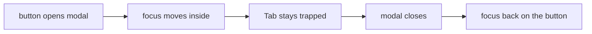

# `tests/e2e/a11y/` — modal keyboard accessibility

Checks that modals work from the keyboard: each is a named `role="dialog"` with
`aria-modal`, focus moves into it when it opens, Tab and Shift+Tab stay inside it,
and focus returns to the button that opened it when it closes. Tagged `@a11y`.

## What's here

| Path | What it is |
| --- | --- |
| [`modal-focus.spec.ts`](modal-focus.spec.ts) | Desktop: work-item details and create-graph modals. Phone: the create-work-item modal from the + button. Cases skip (with a reason) when the control is not on screen. |

## How to run

This folder is collected by the default Playwright project, so `npm run test:e2e`
runs it. No unified sequence or CI step names it. Related keyboard checks live in
[`e2e/ui/`](../ui/README.md) (Escape and click-outside) and in the
[UI fit gate](../../devices/README.md) (accessible names).

Up: [`tests/e2e/`](../README.md)
