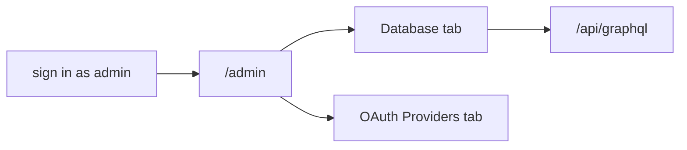

# `tests/e2e/admin/` — admin panel tabs

Checks two tabs of the `/admin` panel while signed in as the admin test user. They
look for the expected controls and that the page loads without errors.

## What's here

| Path | What it is |
| --- | --- |
| [`database-tab.spec.ts`](database-tab.spec.ts) | Database tab: statistics without errors, Refresh Stats, Check Data Integrity and Cleanup Database buttons, requests go to `/api/graphql`, API errors are handled. |
| [`oauth-provider-config.spec.ts`](oauth-provider-config.spec.ts) | OAuth Providers tab: Google, LinkedIn and GitHub sections, enable toggles, Client ID / Client Secret inputs with show/hide, callback URLs and Save Configuration. |

## How to run

Collected by the default Playwright project (`npm run test:e2e`). No unified
sequence or CI step names these files. The OAuth mock data used by other OAuth
tests is in [`tests/fixtures/`](../../fixtures/README.md).

Up: [`tests/e2e/`](../README.md)
