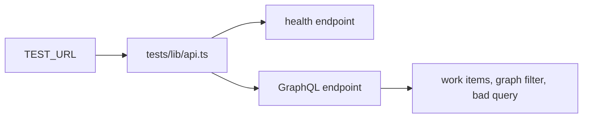

# `tests/e2e/api/` — API health

Request-level checks of the server, with no browser page. Every URL comes from
`TEST_URL` through `tests/lib/api.ts`, so the same spec works against the dev proxy
and the production nginx layout, and data queries sign in the way the UI does.

## What's here

| Path | What it is |
| --- | --- |
| [`health.spec.ts`](health.spec.ts) | The health endpoint answers (`@core`); GraphQL returns work items for a signed-in user, filters them by graph, and handles an invalid query cleanly. |

## How to run

Collected by the default Playwright project (`npm run test:e2e`).
`npm run test:e2e:core` runs only `@core` tests, which includes the health check.

Up: [`tests/e2e/`](../README.md)
