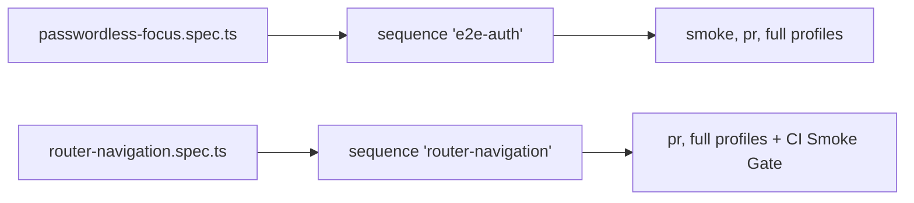

# `tests/e2e/auth/` — sign-in, sign-up and routes

Checks the sign-in and sign-up pages and that app routes keep working for signed-in
and signed-out people. Two of these specs are named sequences in
[`unified.config.mjs`](../../sequences/README.md), so they block PRs.



## What's here

| Path | What it is |
| --- | --- |
| [`passwordless-focus.spec.ts`](passwordless-focus.spec.ts) | Switching to Passwordless puts the cursor in the email field when it is empty, and in the captcha when an email is already there. `@loginfocus` |
| [`router-navigation.spec.ts`](router-navigation.spec.ts) | At 1440 px and 390 px: public deep links, callback errors, unknown paths, lazy pages, back/forward history, viewer route guards and a fresh-context login callback. `@router` |
| [`form-validation.spec.ts`](form-validation.spec.ts) | Sign-in shows inline required errors with `aria-invalid`; create-graph and create-work-item stay disabled until valid; admin create-user warns on empty submit. `@validation` |
| [`responsive-layout.spec.ts`](responsive-layout.spec.ts) | `/signup` puts branding beside the form on a large screen and stacks without sideways scroll on a phone. `@signup-fit` |

## How to run

```bash
TEST_URL=http://localhost:3127 npm run test:unified:smoke          # includes e2e-auth
TEST_URL=http://localhost:3127 node tests/run-unified.mjs --sequence router-navigation
```

`form-validation` and `responsive-layout` run only with the default project
(`npm run test:e2e`).

Up: [`tests/e2e/`](../README.md)
