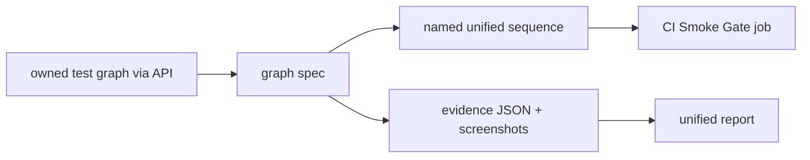

# `tests/e2e/graph/` — the graph canvas

The largest e2e domain: specs for the graph view, where people place, connect and
edit work items. Most newer specs create their own graph through the API with the
`ownedGraphIdsFixture` helper and delete it afterwards, so they do not depend on
demo data. Many are wired into blocking unified sequences that CI runs in the
"Smoke Gate" job.



## What's here (grouped by the sequence that runs them)

| Sequence | Specs | What they check |
| --- | --- | --- |
| `e2e-graph` | `camera.spec.ts` | Graph loads framed, zoom-to-fit, saved pan per graph, slow loads, resize. |
| `inspector-readability` | `inspector-readability.spec.ts` | Inspector code and nested previews stay readable at several widths. |
| `semantic-lod` | `semantic-lod.spec.ts`, `local-item-lod.spec.ts` | Zoomed-out overview keeps all 301 items and layout; busy items keep readable neighbours. |
| `nested-lod` | `nested-semantic-lod.spec.ts` | Nested summaries keep selection, relationships and layout through zoom. |
| `item-wires` | `item-wire-consumers.spec.ts`, `topology-organization.spec.ts`, `item-symbols.spec.ts`, `relationship-priority.spec.ts` | Wire paths, hit areas, arrows, labels, ring organisation and card symbols. |
| `large-symbols` | `large-graph-symbols.spec.ts` | 2000 items and 5000 relationships survive overview and detail zoom. |
| `layout-recovery` | `layout-recovery.spec.ts` | The latest drag survives reloads, crashes, logout, storage failures and retries. |
| `new-user` | `guest-dialog-layout`, `responsive-real-workflows`, `overview-board-actions`, `recorded-ai-work`, `admin-dialog-responsive`, `quick-edit-write-order` | Dialogs fit small screens; API progress shows up in the workspace; the last quick edit wins. |
| `mobile` (by tag) | `fit-focus.spec.ts` | Zoom to fit settles and focus returns to quick edit (`@mobile`). |
| CI step only | `living-graph-effects.spec.ts` | Breathing, glow, energy flow, hover highlight and reduced motion actually render. |
| default project only | `node-quick-edit.spec.ts`, `node-inspector-copyid.spec.ts`, `relationship-flip.spec.ts`, `local-cloud-progress.spec.ts` | Quick editor fields and notes, copy-id chip, edge flip. The last one skips unless `GRAPHDONE_LOCAL_CLOUD=1`. |

## How to run

```bash
TEST_URL=http://localhost:3127 node tests/run-unified.mjs --sequence item-wires
TEST_URL=http://localhost:3127 npm run qc:lod     # semantic-lod.spec.ts, headed
```

Swap `item-wires` for any sequence above. Sequence definitions are in
[`tests/sequences/`](../../sequences/README.md). Helpers such as
`ownedGraphIdsFixture`, `graphRequest` and `seedGraph` are in
[`tests/lib/`](../../lib/README.md).

Up: [`tests/e2e/`](../README.md)
