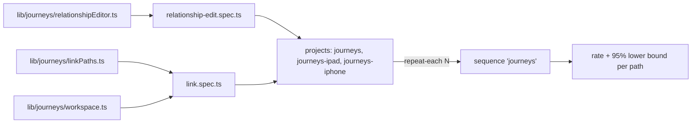

# `tests/e2e/journeys/` — basic user journeys

Measures how reliably a person can do a basic thing, by every way the app offers,
on desktop, iPad and iPhone. The journeys are "connect two items" and "edit a
relationship". Each trial starts on the real landing page in a fresh browser, makes
two items with the normal controls, connects them, and checks what is drawn, what
was saved, and that it survives a reload. Repeats become a success rate per path and
device, with a 95% Wilson lower bound, in the unified report.



## What's here

| Path | What it is |
| --- | --- |
| [`link.spec.ts`](link.spec.ts) | One `JOURNEY link <path>` test per way to connect (from [`tests/lib/journeys/`](../../lib/journeys/README.md)), plus a duplicate check: connecting an already-connected pair says "Already connected" and saves nothing new. Each trial records a `friction` annotation (zoom and pan steps) and `saved-after-ms`. |
| [`relationship-edit.spec.ts`](relationship-edit.spec.ts) | `JOURNEY relationship-edit <path>` (#262): connect two items, open the editor as the device's person does (the label or wire on desktop and iPad, "Browse all relationships" on a phone), then `type` (every type in `RELATIONSHIP_OPTIONS`, then back), `flip` (change type, flip at once without reopening, flip back), `reload`, `delete`, and `second-tab` (self-hosted: another tab shows the change after its one-minute refetch). After each change, with the editor open, it checks the saved data (one relationship for the pair, direction, type, weight), the editor (still "Edit relationship", the direction line, the pressed type) and the canvas (one wire, arrow and label; the type's colour, label text and icon; the arrow at the target); then it closes the editor, brings the arrow into view as a person would (zoom in, drag; a phone opens at half size, where arrows are hidden) and checks that the wire shows the type's colour and the arrow is seen at the target. On a phone the editor fills the screen, so the canvas is checked only once it is closed; then the relationship list entry. A step's findings are compared at once, so a failure lists all that is wrong. No page or GraphQL errors and no "Failed" toast. |

Six paths: + on a card, inspector Connect, Shift-click, Alt-drag, the card menu
(right-click or long-press), quick edit "Details & connections" (Shift/Alt skip on touch).

## Projects and backends

- `journeys` is desktop Chrome at 1440×900. `journeys-ipad` and `journeys-iphone`
  are Chromium with the iPad Pro 11 and iPhone 13 screen, touch and user agent
  (WebKit cannot pinch, and pinching is how a touch user reaches card controls).
- `JOURNEY_BACKEND=selfhost` (default) signs in as the admin test user and reads
  saved connections from GraphQL. `JOURNEY_BACKEND=hosted-guest` enters as a guest
  on the hosted build (graphdone.com) and reads them from the browser's IndexedDB.
- Failures before the journey's own action start with `SETUP:` and are counted
  apart from path failures; skips are not trials. See
  [`tests/lib/reporting/`](../../lib/reporting/README.md) (`reliability`, `wilsonLower`).

## How to run

```bash
TEST_URL=http://localhost:3127 node tests/run-unified.mjs --profile journeys
JOURNEY_REPEAT=30 TEST_URL=http://localhost:3127 node tests/run-unified.mjs --sequence journeys
```

`JOURNEY_REPEAT` sets `--repeat-each` (default 10), with 4 workers and no retries;
`JOURNEY_GREP` limits the run to matching paths (for example `relationship-edit`).
The run may take 6 minutes per repeat before the harness stops it
(`JOURNEY_TIMEOUT_MINUTES` overrides that); Playwright writes no results for a
run that is stopped.
The `journeys` sequence is report-only: not in CI or the `pr`/`full` profiles. The
`relationship-edit` sequence runs that journey once per path and device and is
blocking (CI shard "toolchain, schematic, LOD, layout, relationship edit").

Up: [`tests/e2e/`](../README.md)
