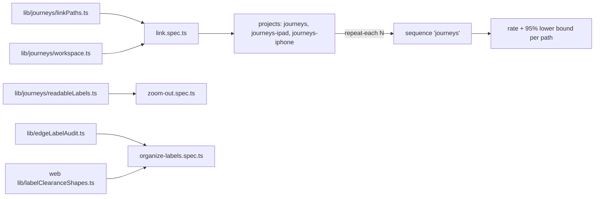

# `tests/e2e/journeys/` — basic user journeys

Measures how reliably a person can do a basic thing, by every way the app offers,
on desktop, iPad and iPhone. The journeys are "connect two items", "organize
the graph with every relationship label readable" and "zoom out". Each link trial
starts on the real landing page in a fresh browser, makes two items with the normal
controls, connects them, and checks what is drawn, what was saved, and that it
survives a reload. Repeats become a success rate per path and device, with a 95%
Wilson lower bound, in the unified report.



## What's here

| Path | What it is |
| --- | --- |
| [`organize-labels.spec.ts`](organize-labels.spec.ts) | `JOURNEY organize-labels`: on Welcome and a twelve-item launch checklist (15 relationships) from [`labelClearanceShapes.ts`](../../../packages/web/src/lib/labelClearanceShapes.ts), press the real "Organize around connections" control (in the View sheet on a phone), then switch to hierarchical. At the camera the app rests on after each, every relationship label is checked from the DOM ([`edgeLabelAudit.ts`](../../lib/edgeLabelAudit.ts)): shown when both cards are on screen, text at least 11 px, under no card, on no other label, hit at its centre, inside its edge's gap; the whole graph is on screen unless the camera is at the smallest zoom where titles and labels still show. Blocking in CI as the `organize-labels` sequence (desktop, iPhone); counts, spread and screenshots are attached. |
| [`zoom-out.spec.ts`](zoom-out.spec.ts) | `JOURNEY zoom-out` (#277): from the Welcome graph of the example project, zoom out to the limit. Every step must show readable text, the level (`data-zoom-level`: items, graph frame, neighbouring graphs, projects) never goes back, the neighbouring graphs and both projects are read by name, nothing is saved, a small wobble does not change the level, and clicking a neighbouring graph opens it. Blocking in CI as the `zoom-out` sequence (desktop, iPad, iPhone); screenshots per level and the steps are attached. |
| [`link.spec.ts`](link.spec.ts) | One `JOURNEY link <path>` test per way to connect (from [`tests/lib/journeys/`](../../lib/journeys/README.md)), plus a duplicate check: connecting an already-connected pair says "Already connected" and saves nothing new. Each trial records a `friction` annotation (zoom and pan steps) and `saved-after-ms`. |

Six paths: + on a card, inspector Connect, Shift-click, Alt-drag, the card menu
(right-click or long-press), quick edit "Details & connections" (Shift/Alt skip on touch).

## Projects and backends

- `journeys` is desktop Chrome at 1440×900. `journeys-ipad` and `journeys-iphone`
  are Chromium with the iPad Pro 11 and iPhone 13 screen, touch and user agent
  (WebKit cannot pinch, and pinching is how a touch user reaches card controls).
- `JOURNEY_BACKEND=selfhost` (default) signs in as the admin test user and reads
  saved connections from GraphQL. `JOURNEY_BACKEND=hosted-guest` enters as a guest
  on the hosted build (graphdone.com) and reads them from the browser's IndexedDB.
- Failures before the journey's own action start with `SETUP:` and are counted
  apart from path failures; skips are not trials. See
  [`tests/lib/reporting/`](../../lib/reporting/README.md) (`reliability`, `wilsonLower`).

## How to run

```bash
TEST_URL=http://localhost:3127 node tests/run-unified.mjs --profile journeys
JOURNEY_REPEAT=30 TEST_URL=http://localhost:3127 node tests/run-unified.mjs --sequence journeys
```

`JOURNEY_REPEAT` sets `--repeat-each` (default 10), with 4 workers and no retries.
The `journeys` sequence (every journey, repeated) is report-only: not in CI or the
`pr`/`full` profiles. `node tests/run-unified.mjs --sequence organize-labels` runs the
organize journey once on desktop and iPhone, and `--sequence zoom-out` runs the zoom-out
journey once per device. Both are blocking (CI shards "toolchain, schematic, LOD, layout"
and "new user, zoom out").

Up: [`tests/e2e/`](../README.md)
