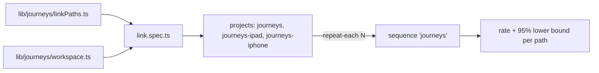

# `tests/e2e/journeys/` — basic user journeys

Measures how reliably a person can do a basic thing, by every way the app offers,
on desktop, iPad and iPhone. So far the journey is "connect two items". Each trial
starts on the real landing page in a fresh browser, makes two items with the normal
controls, connects them, and checks what is drawn, what was saved, and that it
survives a reload. Repeats become a success rate per path and device, with a 95%
Wilson lower bound, in the unified report.



## What's here

| Path | What it is |
| --- | --- |
| [`link.spec.ts`](link.spec.ts) | One `JOURNEY link <path>` test per way to connect (from [`tests/lib/journeys/`](../../lib/journeys/README.md)), plus a duplicate check: connecting an already-connected pair says "Already connected" and saves nothing new. Each trial records a `friction` annotation (zoom and pan steps) and `saved-after-ms`. |

Six paths: + on a card, inspector Connect, Shift-click, Alt-drag, the card menu
(right-click or long-press), quick edit "Details & connections" (Shift/Alt skip on touch).

## Projects and backends

- `journeys` is desktop Chrome at 1440×900. `journeys-ipad` and `journeys-iphone`
  are Chromium with the iPad Pro 11 and iPhone 13 screen, touch and user agent
  (WebKit cannot pinch, and pinching is how a touch user reaches card controls).
- `JOURNEY_BACKEND=selfhost` (default) signs in as the admin test user and reads
  saved connections from GraphQL. `JOURNEY_BACKEND=hosted-guest` enters as a guest
  on the hosted build (graphdone.com) and reads them from the browser's IndexedDB.
- Failures before the journey's own action start with `SETUP:` and are counted
  apart from path failures; skips are not trials. See
  [`tests/lib/reporting/`](../../lib/reporting/README.md) (`reliability`, `wilsonLower`).

## How to run

```bash
TEST_URL=http://localhost:3127 node tests/run-unified.mjs --profile journeys
JOURNEY_REPEAT=30 TEST_URL=http://localhost:3127 node tests/run-unified.mjs --sequence journeys
```

`JOURNEY_REPEAT` sets `--repeat-each` (default 10), with 4 workers and no retries.
Report-only: not in CI or the `pr`/`full` profiles.

Up: [`tests/e2e/`](../README.md)
