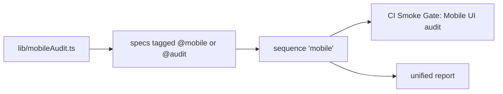

# `tests/e2e/mobile/` — phone audits

Checks that the app is usable on a phone: no sideways scrolling, readable text,
dialogs that fit and sit above the bottom navigation, and touch on the graph. Every
spec is tagged `@mobile` or `@audit`; the `mobile` sequence selects tests by those
tags (it also picks up `graph/fit-focus.spec.ts`).



## What's here

| Path | What it is |
| --- | --- |
| [`accessibility-audit.spec.ts`](accessibility-audit.spec.ts) | Runs the layout and contrast auditors on every view, every page and sign-in at 390×844. `@audit` |
| [`dialog-positioning.spec.ts`](dialog-positioning.spec.ts) | The work-item edit and create modals fit the screen and paint above the bottom nav. `@audit` |
| [`experience.spec.ts`](experience.spec.ts) | A phone lands on a readable list (not the graph), shows no Neo4j chrome, and the bottom nav drives the views. |
| [`view-navigation.spec.ts`](view-navigation.spec.ts) | Every non-graph view reads by scrolling down, never sideways; Calendar opens as an agenda list. |
| [`touch-graph.spec.ts`](touch-graph.spec.ts) | A touch on a locked node previews the task, Edit opens its editor, and the edit is saved. `@touch` |
| [`agent-approval.spec.ts`](agent-approval.spec.ts) | An approved agent connection fits a 320×568 phone; the enrollment API is a local route fixture. |

## How to run

```bash
TEST_URL=http://localhost:3127 npm run test:mobile
TEST_URL=http://localhost:3127 node tests/run-unified.mjs --sequence mobile --out test-artifacts/runs/mobile-check
```

The sequence is blocking, runs one worker with no retries, and is in the `pr` and
`full` profiles. For every screen on real iPhone and iPad profiles, see the
[UI fit gate](../../devices/README.md).

Up: [`tests/e2e/`](../README.md)
